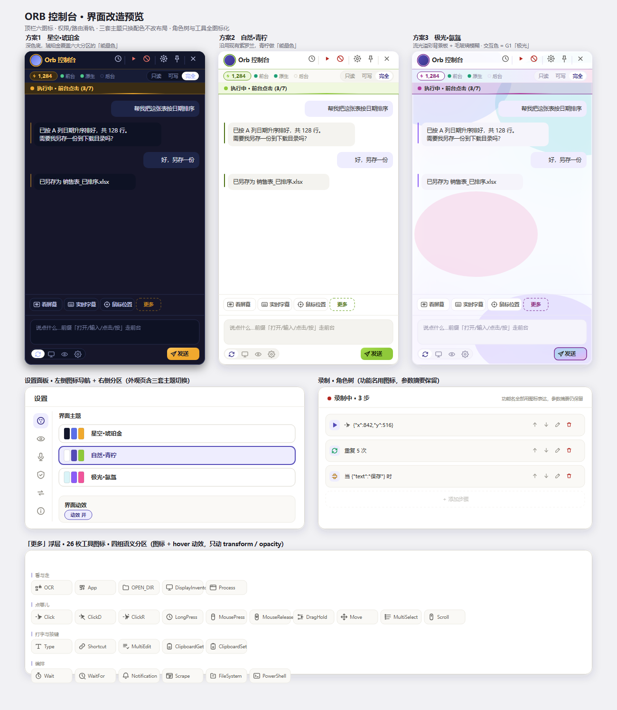

<div align="center">

# ORB Console

**A desktop AI agent that actually operates your PC.**

Say one sentence. It screenshots your screen, figures out where to click, and clicks / types / scrolls for you —
then reports the whole run back to the chat panel. A floating orb stays on your desktop; it gets out of the way when idle.

[简体中文](README.md) · [Download](#download) · [Roadmap](ROADMAP.md)


</div>



---

## Safety first

Handing your mouse to an AI raises one question before any other: *what if it goes rogue?* ORB treats that as a first-class feature:

| Mechanism | Detail |
| --- | --- |
| **Emergency stop** | `Ctrl + Alt + Backspace`, or the red stop button in the top bar. Interrupts mid-action, nothing keeps running in the background |
| **Permission tiers** | Read-only / Workspace-writable / Full access. Persisted per session. No vision loop unless you grant full access |
| **Observation border** | The target window lights up with a border while a foreground action runs, so you always see *what* is being operated |
| **Human confirmation** | Irreversible actions (delete, pay, send) must raise a confirmation first |
| **Token auth** | Every bridge endpoint requires a `X-Orb-Token` generated at process start. No random web page can drive your PC |
| **No telemetry** | None. Keys stay in memory — never written to disk or logs |

---

## Three execution tracks

One sentence in, ORB picks the track — or you force one manually.

| Track | What it does | Good for |
| --- | --- | --- |
| **Foreground** | Drives your PC directly: click, type, hotkeys, scroll, press-and-hold, drag, screenshot | Launching apps, filling forms, tidying files |
| **Background** | Dispatches heavy work to a local agent (headless, one-shot), results stream back | Reading a codebase, writing long documents, batch jobs |
| **Vision** | A `screenshot → vision model → action → screenshot` loop; the model decides the next click itself | Apps with no API that you can only drive by looking |

Vision coordinates use **per-mille (0–1000)** instead of pixels, so high-DPI screens don't make the model miscount;
it can `zoom` / `reset` the viewport on its own, and falls back to a secondary model when the primary fails.

---

## Download

| Option | Size | Notes |
| --- | --- | --- |
| **Portable single-file `.exe`** | ~208 MB | Grab `ORB-Console-<version>-portable.exe` from [Releases](https://github.com/zhoukr123/ORB-Console-made-for-workbuddy/releases) and double-click |
| **Portable `.zip`** | ~208 MB | Same release; unzip and run the launcher inside |
| **Run from source** | — | Requires Node.js 22+, see below |

The portable build is a **self-extracting single file**: it unpacks itself to `%LOCALAPPDATA%\ORBConsole` and starts.
No installer, no registry writes, no need for a pre-installed Node or Python (runtimes ship inside).

- Data directory: `%APPDATA%\ORB 控制台`
- Uninstall: run `uninstall-ORB-Console.cmd` next to it
- SmartScreen may warn on first run — choose "More info → Run anyway" (no signing certificate yet)
- GitHub forces ASCII asset names; the Chinese names appear in each asset's description text

### Run from source

```bat
:: Requires Windows 10/11 x64 and Node.js 22+
npm install --prefix orb
npm install --prefix orb/desktop

:: then launch
双击 "启动 ORB 控制台.cmd"
```

---

## Features

| Feature | Detail |
| --- | --- |
| Floating orb | Always on top; hover to expand, click to pin, drag to reposition (remembered), drag off-screen to dock as a thin tab |
| Conversational control | Input is auto-routed to foreground / background, or you pick |
| Select-to-act | Select any text and a toolbar pops up (search / translate / send to agent) — no global keyboard hook |
| Voice input | Streaming transcription from the mic button. Pluggable engine: browser Web Speech or your own Whisper endpoint |
| Vision loop | Per-mille coordinates + active zoom + automatic model fallback |
| Screen recording | Native MP4 output (1080p / 30fps) with a floating control bar: pause / resume / cancel / finish (v1.1.0) |
| Screenshot | Invokes your local Snipaste for selection and annotation, archives into your storage folder (v1.1.0) |
| Four themes | Deep Space / Daylight / Aurora / Custom gradient; frosted glass available on Deep Space and Custom |

---

## Third-party components

This repo ships **only its own source, docs and build scripts** — no third-party proprietary software:

- **WorkBuddy / CodeBuddy Code CLI** (Tencent, proprietary) is *not* bundled. The background track calls the CLI you installed yourself.
- Selection, screenshot and window operations come from MCP services you installed yourself.
- The screenshot feature invokes **Snipaste** if you have it installed; ORB only detects, invokes and archives.
- See [THIRD-PARTY-NOTICES.md](THIRD-PARTY-NOTICES.md).

> "ORB" refers to the floating-orb form factor. This project is **not affiliated** with DeepSeek Orb or any other same-named product.

---

## Contributing

Issues and PRs are welcome. Please read [CONTRIBUTING.md](CONTRIBUTING.md) and the
[Code of Conduct](CODE_OF_CONDUCT.md) first; security reports go to [SECURITY.md](SECURITY.md);
what's next lives in [ROADMAP.md](ROADMAP.md).

---

## License

[MIT](LICENSE)
