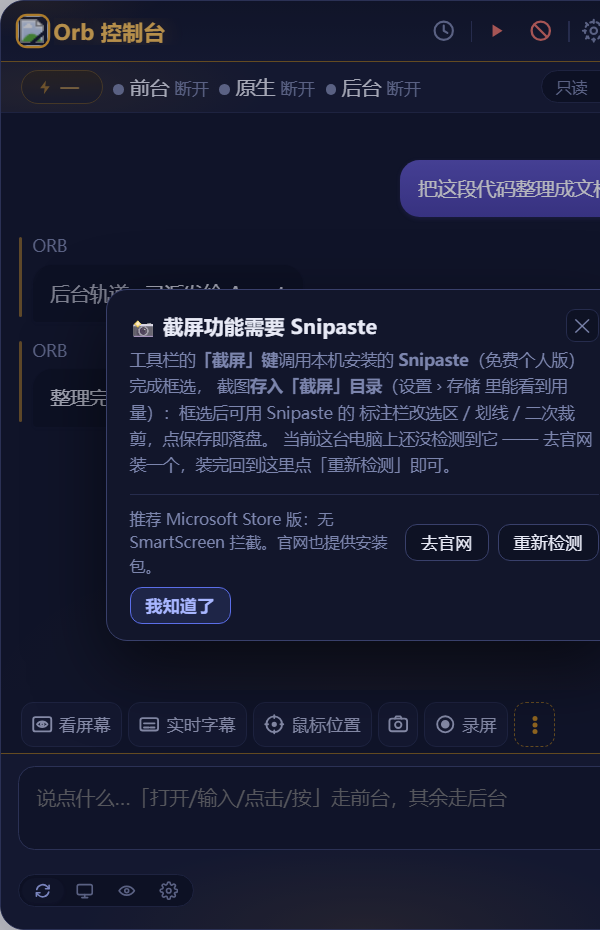
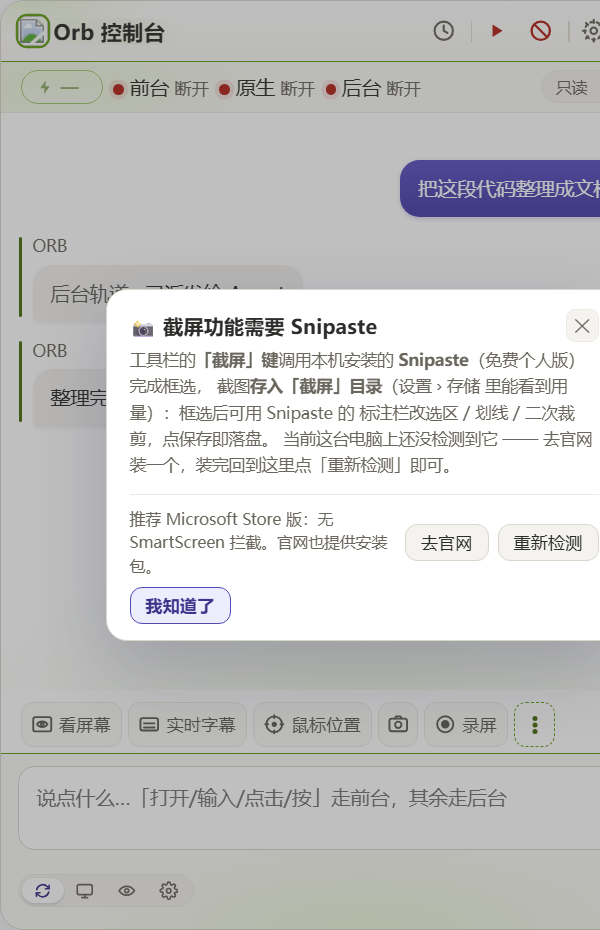
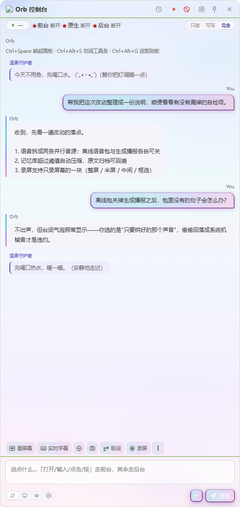
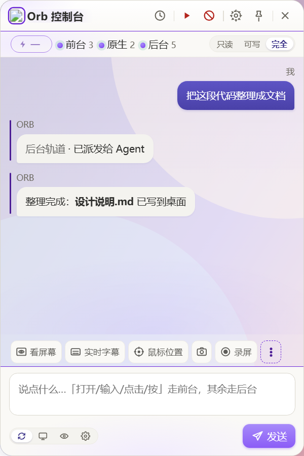

<div align="center">

<p><a href="https://github.com/zhoukr123/ORB-Console-made-for-workbuddy#readme"></a></p>
# ORB 控制台

**一个真的会替你操作电脑的桌面 AI 员工。**

说一句话，它自己截图看屏幕、判断该点哪里、替你点击 / 输入 / 滚动 —— 做完把整个过程回给你。
悬浮球常驻桌面，不用的时候停在角落。

[English](README.en.md) · [下载](#下载) · [文档](使用说明.md) · [路线图](ROADMAP.md)


<p align="center"><sub>为 WorkBuddy / CodeBuddy 生态而建 · 后台轨道直接调用你本机的 CodeBuddy CLI，无需另配 Key</sub></p>

</div>


---

## 先说安全：它会动你的鼠标，所以先给了急停

把鼠标键盘交给 AI，你第一个问题一定是「它乱来怎么办」。ORB 把这件事当成第一功能来做：

| 机制 | 说明 |
| --- | --- |
| **急停** | `Ctrl + Alt + Backspace` 一键中断，或顶栏红色急停按钮。随时可打断，不留后台动作 |
| **权限分级** | 只读 / 工作区可写 / 完全访问三档，随会话保存，切换即时生效。不开「完全访问」就不会有视觉循环 |
| **观察边框** | 前台执行时目标窗口亮起一圈边框，你能实时看到「它正在操作谁」 |
| **人工确认** | 删除、支付、发送等不可逆操作，模型必须先发起确认 |
| **令牌鉴权** | 桥接层每个接口都要启动时随机生成的 `X-Orb-Token`，浏览器里的任意网页无法遥控你的电脑 |
| **零遥测** | 项目不含任何遥测；密钥只在内存里过一遍，不落盘、不写日志 |

---

## 三条执行轨道

同一句自然语言，ORB 会自己判断该走哪条路；你也可以手动指定。

| 轨道 | 干什么 | 适合 |
| --- | --- | --- |
| **前台轨道** | 直接操作你的电脑：点击、输入、快捷键、滚动、长按、拖动、截图看屏幕 | 打开软件、填表单、整理文件这类「手上的活」 |
| **后台轨道** | 把重活派给 Agent（headless 一次性执行），跑完自动回填结果 | 读代码库、写长文档、跑批处理这类「动脑的活」 |
| **视觉轨道** | 「截图 → 视觉模型 → 动作 → 再截图」的闭环，模型自己决定下一步点哪里 | 没有 API、只能靠看的软件 |

视觉轨道的坐标用 **千分比（0–1000）** 而不是像素，避免高分辨率下模型数错位置；
支持主动 `zoom` / `reset` 调整视野；主力模型失败自动切备选。

<p align="center">
  
  <br>
  <sub>↑ 一句「打开记事本，写一句 Hello ORB」：它自己截图找位置 → 点击 → 输入 → 回填结果</sub>
</p>

---

## 下载

| 方式 | 体积 | 说明 |
| --- | --- | --- |
| **便携单文件 `.exe`** | 约 210 MB | [Releases](https://github.com/zhoukr123/ORB-Console-made-for-workbuddy/releases) 下载 `ORB-Console-<版本>-portable.exe`，双击即用 |
| **便携包 `.zip`** | 约 210 MB | 同一个 Release 里的 zip，解压后运行里面的启动脚本 |
| **从源码运行** | — | 需要 Node.js 22+，见下 |

便携版是**自解压单文件**：运行后把自己展开到 `%LOCALAPPDATA%\ORBConsole` 并启动，
不安装、不写注册表、不需要预装 Node 或 Python（运行时随包自带）。

- 数据目录：`%APPDATA%\ORB 控制台`
- 卸载：运行同目录下的 `uninstall-ORB-Console.cmd`
- 首次运行如遇 SmartScreen 提示，选「更多信息 → 仍要运行」（发布物尚未签名，见下文）
- GitHub 会把发布资产的文件名强制转成 ASCII，中文名显示在每个资产右侧的说明文字里

### 从源码运行

```bat
:: 前置：Windows 10/11 x64、Node.js 22+
npm install --prefix orb
npm install --prefix orb/desktop

:: 起面板
双击「启动 ORB 控制台.cmd」
```

### 首次使用

1. **配置视觉模型** —— 设置（顶栏齿轮）→「视觉模型」，填接口地址、模型名、API Key。
   没有 key 时可选「自检」预设，用脚本化响应跑通除第三方接口外的全部环节。
2. **选择权限** —— 状态条右侧滑轨，日常用「工作区可写」。
3. **直接说** —— 例如 `打开记事本`、`截个图`、`把这段代码整理成文档发到桌面`。

---

## 功能一览

| 能力 | 说明 |
| --- | --- |
| 悬浮球交互 | 常驻置顶；悬停展开、单击固定、拖动换位并记忆、拖出屏幕边缘收纳成细签 |
| 对话式操作 | 输入框按内容自动分流到前台 / 后台，也可手动指定 |
| 划词即用 | 拖拽划选文字后工具条自动弹出（搜索 / 翻译 / 发给 Agent），不注册任何全局键盘钩子 |
| 语音输入 | 麦克风按钮流式转写。引擎可插拔：浏览器 Web Speech 或自建 Whisper 端点 |
| 视觉决策循环 | 千分比坐标 + 主动缩放 + 失败自动切备选模型 |
| 录屏 | 原生直出 MP4（桌面复制直出，不依赖外部编码器）；悬浮控制条可暂停 / 继续 / 取消 / 完成；录完即停计时器更省电、短录制不留垃圾、连续截屏各归各位（v1.3.0 原生 MP4，v1.3.5 省电与清理） |
| 截屏 | 唤起本机 Snipaste 框选标注，文件名带毫秒、连按也各归各位；录屏中自动排除 ORB 自身（v1.3.5 引用计数加固） |
| 托盘常驻 | 应用身份交给右下角托盘图标：左键开关面板、右键菜单唤起；不再占任务栏与 Alt+Tab（v1.3.5） |
| 工作流进度 | 运行任务时显示进度条，每一步都有反馈（v1.3.5） |
| **工作流录制** | 顶栏「录操作」录一遍操作，录制中该键变成红底白方块（完成键）并呼吸；录好的工作流在「设置 › 截屏与录屏 › 工作流」里回放 / 改步骤 / 用 AI 写一条（v1.3.6） |
| **功能查找** | `Ctrl + K` 只做功能查找：搜到即执行。工作流与会话历史各有入口，不再混在一个搜索框里（v1.3.6） |
| **设置面板分段** | 「截屏与录屏」页切成录屏 / 截屏 / 工作流三大块，每块独立成框带大标题；标题旁的交关线在指向该块时延展并染上主题色（v1.3.6） |
| **工作流：遇到意外怎么办** | 每条工作流可填「目标」并选策略：照坐标继续 / 停下来报错 / 先问一次视觉模型 / 交给智能体顶几步再回原流程。后两档只在配了锚定文字、且那句话确实找不到的步骤上触发，其余步骤永远纯回放（v1.4.0） |
| **智能接管** | 回放半路找不到目标时，视觉模型顶一小批动作把流程推回正轨。判定权在后端：它自己截图 OCR 判断有没有回到轨道；循环里会点明第几轮，避免整段被跳过（v1.4.0） |
| **循环轮次标记** | 圈出「每轮都会做一次」的动作当标记，界面失守时靠审计表数它执行了几次，推定已经完成几轮（v1.4.0） |
| **重复片段折叠** | 录完若发现几段几乎相同的操作，给一句话加一个「折叠成循环」按钮，点一下才改——不擅自改你的结构（v1.4.0） |
| **触发器内联** | 定时 / 文件变化 / 热键直接在每条工作流的编辑面板底部管理，启用停用删除都在那儿，不用再翻命令面板（v1.4.0） |
| **工作流列表与审计** | 回放 / 编辑 / 删除改成三枚图标键，删除要输入「删除」二字确认；审计日志搬进「设置 › 存储」（v1.4.0） |
| **五个人格** | 温柔守护者 / 元气开心果 / 上进小战友 / 智慧小向导 / 正能量傲娇，各有台词库、口吻、颜文字与音色，在「设置 › 个性」里选。原「元气小太阳」与「开心果」已合并，老配置自动迁移（v1.5.0） |
| **AI 台词** | 打开后每派一个任务多一次模型调用，一次生成整轮要用的台词（过程三句 + 成功/失败收尾各一句），按真实进度放出来。过程句只说「哪类动作」，不说具体文件名行号——事实归程序，措辞归模型；失败一律静默退回预定台词（v1.5.0） |
| **自定义模型（可接管后台）** | 填自己的 OpenAI 兼容接口（地址 / 模型名 / Key / 接管后台任务开关）。开着就把接口注册进 CLI 的模型清单、派任务时交给 CLI 去调——工具编排、急停、审计全复用，只增删自己那条记录，动前先备份 `.orb-bak`。Key 只存本机、读回只显示后四位，弹窗里能一键「测试」真发请求（v1.5.0） |
| **消耗都算在任务里** | 状态条显示合计 token 与台词分项（`13.1k tok（台词 680）`），走自定义接口时标「自定义」；积分弹窗按任务列出输入 / 输出 / 台词 / 成败，失败也记。自定义模型花的是你自己的额度，不再误报「未登录」（v1.5.0） |
| **悬浮球专属行为** | 完成 / 打招呼 / 加载 / 点头 / 害羞 / 思考 / 晚安七张动图分工明确，可整体关也可单关；空闲两分钟随机播一张；傲娇被夸会害羞这类专属行为已接上（v1.4.0） |
| **个性台词气泡** | 念出来的每句台词都会在对话里留一条小气泡（比正文淡一号、跟主题强调色）。声音关着也照样显示——以前台词只走语音、一个字不显示，等于个性隐身（v1.4.0） |
| **精简念白** | 默认只在完成 / 失败 / 被夸 / 里程碑 / 深夜 / 久坐这类有结果有情绪的节点开口，「收到」「执行中」省掉；可在「设置 › 个性 › 声音」切回完整版（v1.4.0） |
| 四套主题 | 深空 / 白昼 / 极光·氤氲 / 自定义（整窗图片），一键切换；极光另带 6 款渐变；自定义渐变拖动实时跟手（v1.3.5 跟手优化） |
| 首跑向导 | 首次启动自动体检四条通道（前台 / 语音 / 视觉 / 后台），逐条给出可用状态 |

### 工作流：录完之后，还得扛得住改版（v1.4.0）

录制回放最容易翻车的地方不是录，是**放**：过两天按钮挪了位置、多了个弹窗，回放就一路点空。
现在每条工作流多了「目标」和「遇到意外怎么办」两个字段，四档策略自己挑：

| 策略 | 什么时候选 |
| --- | --- |
| 照录制坐标继续 | 不调模型，最快；点错了也没事的流程 |
| 停下来并报错 | 宁可不做也不乱点；会改数据的流程 |
| 先问一次视觉模型 | 卡住那一步问一次该怎么走 |
| 交给智能体顶几步 | 让视觉模型推回正轨，再交还回放 |

后两档只在**配了锚定文字、且那句话确实找不到**的步骤上触发，其余步骤永远纯回放，所以不会因为开了它就每条都变慢。

配套的还有：循环节点可配「轮次标记」（靠审计表数它执行了几次来推定完成几轮）；录完发现几段相同操作会建议折成循环但不擅自改；定时 / 文件 / 热键三类触发器搬进每条工作流的编辑面板底部。

### 个性系统：五个人格，和它们的台词（v1.4.0 / v1.5.0）

个性是一个**陪伴层**，和后台 AI 的回答是两条独立的线——人格不会去改 AI 回答的内容，只是旁边有个家伙在嘟囔。
在「设置 › 个性」里挑一个：温柔守护者 / 元气开心果 / 上进小战友 / 智慧小向导 / 正能量傲娇，
各自有台词库、口吻、颜文字和音色；悬浮球那七张动图也会跟着演。

念出来的台词现在会**显示在对话里**（小一号、淡色、左边一道细线），关了声音也照样有——
以前它们只走语音合成，一个字都不显示，等于个性隐身。默认还开了「精简念白」：
一个任务只在完成、失败、被夸这类有结果的节点念一句，「收到」「执行中」省掉，想听完整版可随时切回。

### AI 台词：现编的，但不是瞎说（v1.5.0）

台词不再全是写死的。打开「设置 › 个性 › AI 台词」（默认关）之后，每派一个任务会**多一次模型调用**，
这一次把整轮要用的话一次性生成好：过程三句、成功一句、失败一句。成本等同「结尾现编一次」，
但整个过程都有这个人格自己的说法。

分工划得很死：**什么时候说、说到第几句、说的是哪类动作，由程序按真实工具调用决定；这句话怎么措辞，由模型按人格决定。**
工具名会被映射成泛化动作（读文件 / 搜代码＝翻箱子，改文件＝动笔，跑命令＝拧螺丝，认不出的就不说），
所以它宁可少说一句，也不会编一个不存在的文件名。最多三句、同工具不重复、两句至少隔六秒。

任何失败（没配接口、接口挂了、超时、输出解不出 JSON）都静默退回预定台词，你看到的就是旧行为。
关掉开关则一次额外调用都不发生。

想让它说得更快、不占 CLI 额度，可以在「设置 › 通道 › 后台 Agent › 自定义模型」填自己的 OpenAI 兼容接口。
把「接管后台任务」开着，这个接口还能直接干活：控制台会把它注册进 CLI 的模型清单，派任务时交给 CLI 去调，
读文件、跑命令、调工具全是 CLI 在做。代价是你的接口得支持 function calling，模型名也要和接口文档写的一模一样。
它花掉的 token 会和台词那笔一起记在状态条与积分弹窗里，不会变成看不见的支出。

> 「个性 › 记忆」这一档目前只记下你的选择（项目记忆 / 会话记忆），真正去读文件还没接上。

### 四套主题

| 深空 | 白昼 |
| --- | --- |
|  |  |

| 极光·氤氲（6 款渐变之一） | 自定义（整窗图片，示例壁纸） |
| --- | --- |
|  |  |

---

## 架构速览

```
你说话
  │
  ├─ 前台轨道 ──► 原生输入原语（orb-input.c）──► 真的动鼠标键盘
  │                 ▲
  │                 └─ 视觉轨道：截图 → 视觉模型 → 千分比坐标 → 动作 → 再截图
  │
  └─ 后台轨道 ──► 本机 CodeBuddy CLI（headless）──► 结果回填对话区
```

所有能力都通过本机的 HTTP 桥进程（端口 19387）暴露，桥带令牌鉴权；
面板是单文件渲染层（全部内联 SVG，零外部资源）。

```
orb/
  bridge.mjs              HTTP 桥进程（端口 19387）：MCP 服务代理 + 令牌鉴权
  runtime.mjs             运行时（Python / Node）定位的单一真相源
  pack.cjs                一键打包：便携目录 → zip → 自解压单文件
  selftest.mjs            全链路自检
  sign.cjs                代码签名（含自解压包的签名兼容校验）
  desktop/
    main.js               Electron 主进程（多窗口、托盘、快捷键、划词、桥的拉起与回收）
    panel.html            面板（单文件渲染层）
    ball.html             悬浮球
    toolbar.html          划词工具条
    recbar.html           录屏悬浮控制条
    border.html           观察边框
  native/
    src/orb-input.c       原生鼠标原语（长按 / 按住 / 拖动 / 滚轮）
    src/orb-sfx.c         自解压桩（签名感知）
asr/                      本地 Whisper 语音识别服务（可选）
```

---

## 自检

```bat
node orb\selftest.mjs          :: 只读链路检查
node orb\selftest.mjs --full   :: 额外跑一次真实后台任务（会消耗模型额度）
```

覆盖：启动产物、令牌鉴权、三条服务通道、原生输入原语逐个实调、
异常边界（未知服务 / 畸形 JSON / 越界参数）、面板可用性。退出码 0 表示全绿。

---

## 参与贡献

欢迎提 Issue 和 PR。开始之前请先读 [CONTRIBUTING.md](CONTRIBUTING.md) 与 [行为准则](CODE_OF_CONDUCT.md)，
安全问题请看 [SECURITY.md](SECURITY.md)，下一步做什么看 [ROADMAP.md](ROADMAP.md)。

---

## 关于第三方组件

本项目**只包含自研源码、文档与构建脚本**，不随仓库或发布物分发任何第三方专有软件：

- **WorkBuddy / CodeBuddy Code CLI** 是腾讯的专有软件。后台轨道调用你**本机自行安装**的
  CodeBuddy CLI，仓库和发布包中都不包含它。请自行安装并遵守其许可条款。
- 划词、截图、窗口操作等能力通过你本机自行安装的 MCP 服务提供，同样不随本项目分发。
- 截屏功能唤起你本机安装的 **Snipaste**（闭源免费软件），ORB 只做「检测 + 唤起 + 归档」，不含其代码。
- 第三方组件的许可与归属见 [THIRD-PARTY-NOTICES.md](THIRD-PARTY-NOTICES.md)。

> 名字里的 ORB 指悬浮球形态，与 DeepSeek Orb 及其它同名产品**没有关联**；
> 与腾讯 WorkBuddy / CodeBuddy **也无隶属关系**，本项目是独立的第三方作品。能力对照见
> [功能对标分析.md](功能对标分析.md)。

---

## 关于图标

应用图标是**圆角方形蓝底 + 白色图形**，为本项目自有的视觉标识：

- 不使用任何第三方产品的图形元素；
- 圆角方形与蓝白配色属于**通用视觉语言**（不受著作权保护），仅用于与所处生态保持视觉一致；
- 多档位源文件在 [`docs/icon/`](docs/icon/)（1024 / 512 / 256 / 64）。

---

## 关于代码签名

发布物目前**未签名**，所以 Windows 会弹 SmartScreen。点「更多信息 → 仍要运行」即可继续；
签名工具 `orb/sign.cjs` 已就绪，待获取一张受信任的代码签名证书后会补上。无签名不影响功能，仅首次运行多一步确认。

---

## 常见问题

**会让 AI 在我不知情的情况下操作电脑吗？**
不会。不开「完全访问」权限就没有视觉循环，前台动作都有观察边框，`Ctrl + Alt + Backspace` 随时中断。

**必须装 CodeBuddy / WorkBuddy 吗？**
后台轨道需要你本机装有 CodeBuddy CLI。前台轨道、视觉轨道、录屏、截屏不依赖它。

**没有视觉模型的 API Key 能用吗？**
能。设置里选「自检」预设，可用脚本化响应跑通除第三方接口外的全部环节。

**为什么便携包有 210 MB？**
它自带 Electron 运行时和 Node/Python 依赖，换来了「不装任何东西也能双击运行」。介意的话可以用源码方式运行。

---

## 文档

| 文档 | 面向 |
| --- | --- |
| [使用说明.md](使用说明.md) | 使用者：界面速览、操作方式、常见问题、环境变量、彻底卸载 |
| [更新说明-v1.5.0.md](docs/更新说明-v1.5.0.md) | 使用者：这一版加了什么、用起来什么感觉（更早版本见 `docs/` 下同名文件） |
| [ROADMAP.md](ROADMAP.md) | 所有人：接下来三个版本做什么 |
| [CONTRIBUTING.md](CONTRIBUTING.md) | 贡献者：怎么跑起来、怎么提 PR |
| [orb/README.md](orb/README.md) | 开发者：各模块实现细节与踩坑记录 |
| [orb/desktop/打包与发布说明.md](orb/desktop/打包与发布说明.md) | 维护者：打包流程、包内路径契约、发布检查清单 |

---

## 许可

[MIT](LICENSE)
