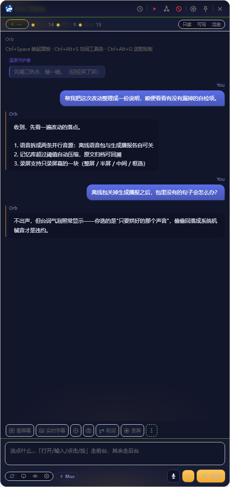
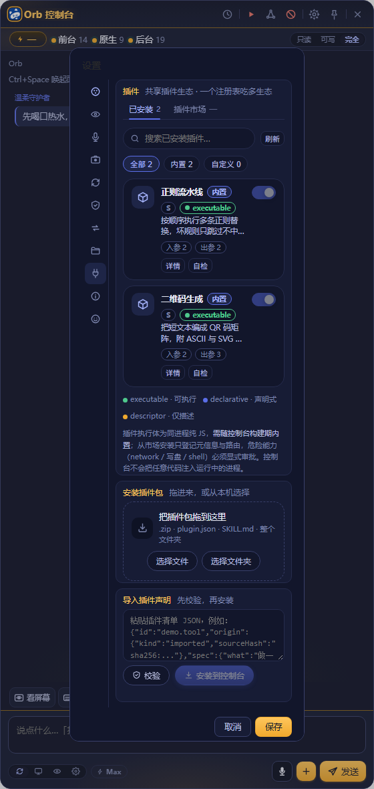
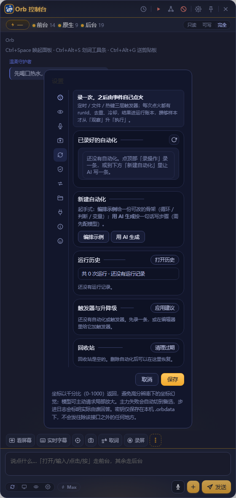
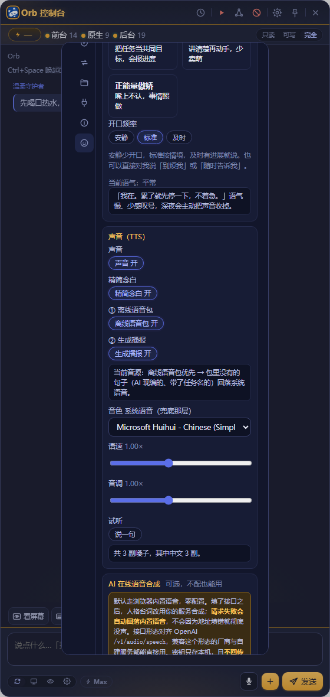
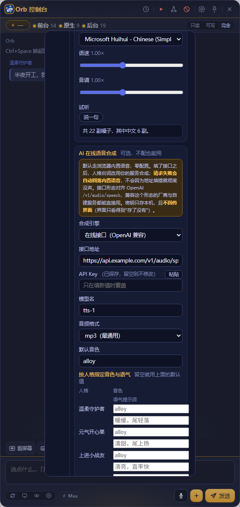
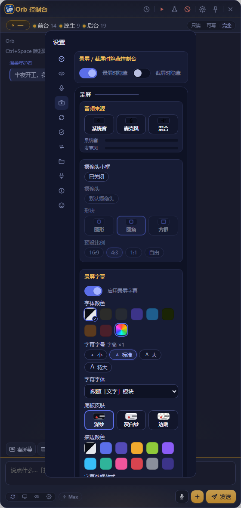
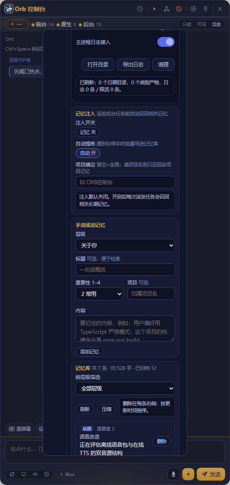
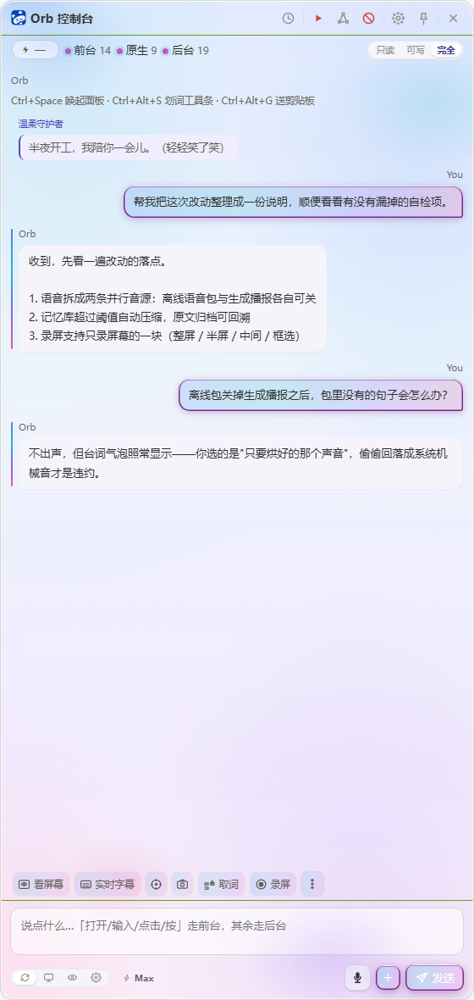
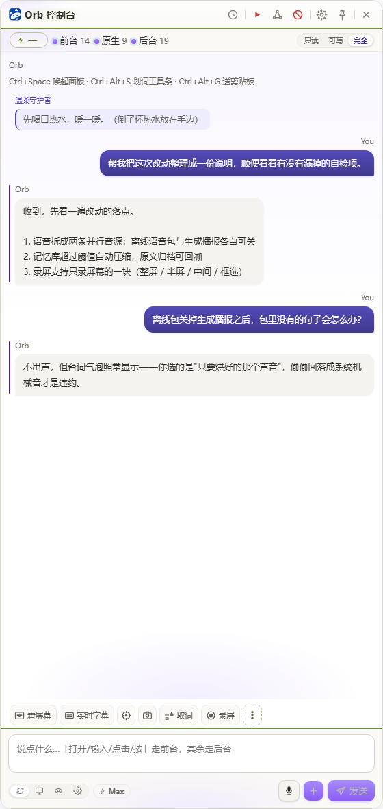

<div align="center">

<p><a href="https://github.com/zhoukr123/ORB-Console-made-for-workbuddy#readme"></a></p>
# ORB 控制台

**一个真的会替你操作电脑的桌面 AI 员工。**

说一句话，它自己截图看屏幕、判断该点哪里、替你点击 / 输入 / 滚动 —— 做完把整个过程回给你。
悬浮球常驻桌面，不用的时候停在角落。

[English](README.en.md) · [下载](#下载) · [文档](使用说明.md) · [更新说明](docs/更新说明-v1.5.0.md) · [路线图](ROADMAP.md)


<p align="center"><sub>为 WorkBuddy / CodeBuddy 生态而建 · 后台轨道直接调用你本机的 CodeBuddy CLI，无需另配 Key</sub></p>

</div>


---

## 这一版（v1.5.0）最值得看的五件事

对标 v1.4.5，这一版的改动量是「换底座」级别：后端模块 **7 → 102**，单测 **0 → 122 个文件**，验收 **1 道自检 → 9 道门禁 + 浏览器通道专项冒烟**。

| 它是什么 | 为什么值得单独说 |
| --- | --- |
| **浏览器快车道** | 装一个扩展，它就能直接读当前页正文、开页面、点元素、输入——**不碰你的鼠标键盘**，也不用「截图猜坐标」。只认 17 条白名单命令，`eval` / `cookie` / `upload` 永远拒绝 |
| **插件能装了** | 「设置 › 插件」把包拖进来就装上，也能从 647 条市场索引里挑。插件产出的东西要过验收闸门才算出结果 |
| **治理四档** | 「专家团」和「Max」是两个正交开关。开了团队才有团队治理；重治理（封驳评审 + 多 agent 带上下文）严格绑定「专家团 + Max」 |
| **自动化扛得住** | 开跑前预检、跑一半能断点续跑、配方有版本能 diff 能回滚、删了进回收站、每次运行都在账本上 |
| **存储收敛成一个根** | 录屏 / 截图 / 导出 / 日志全在 `ORB存储/` 下，按 `<类型>/<日期>/` 分层；迁移器只复制不删除 |

---

## 先说安全：它会动你的鼠标，所以先给了急停

把鼠标键盘交给 AI，你第一个问题一定是「它乱来怎么办」。ORB 把这件事当成第一功能来做：

| 机制 | 说明 |
| --- | --- |
| **急停** | `Ctrl + Alt + Backspace` 一键中断，或顶栏红色急停按钮。前台、后台、排队中的任务一起停，恢复前不再接受新任务 |
| **急停不硬杀** | 全局暂停只挡新工单，**正在跑的不硬杀**——硬杀会留半截状态。要它停在安全点上，不是停在半路 |
| **权限分级** | 只读 / 工作区可写 / 完全访问三档，随会话保存，切换即时生效。不开「完全访问」就不会有视觉循环 |
| **能力时钟** | 每一次「副作用」都签发 capability，执行前后校验是否仍属当代。换档期间老指令失效，不会「上一档的活插到这一档来」 |
| **观察边框** | 前台执行时目标窗口亮起一圈边框，你能实时看到「它正在操作谁」 |
| **人工确认** | 删除、支付、发送等不可逆操作，模型必须先发起确认；浏览器写操作也必须显式带 `confirm` |
| **令牌鉴权** | 桥接层每个接口都要启动时随机生成的 `X-Orb-Token`，浏览器里的任意网页无法遥控你的电脑 |
| **凭据不进日志** | 日志总线做枚举校验 + 白名单 + 脱敏转义，key 只在内存里过一遍 |
| **零遥测** | 项目不含任何联网遥测；「机器遥测」模块只做**只读一次性快照**，不外发 |
| **记忆只在本地** | 长期记忆是一个本地 JSON 文件，召回与压缩都在本机完成；除拼进你自己的任务上下文，不外传 |

---

## 四条轨道 + 一个模式

同一句自然语言，ORB 会自己判断该走哪条路；你也可以手动指定。

| 轨道 | 干什么 | 适合 |
| --- | --- | --- |
| **前台轨道** | 直接操作你的电脑：点击、输入、快捷键、滚动、长按、拖动、截图看屏幕 | 打开软件、填表单、整理文件这类「手上的活」 |
| **后台轨道** | 把重活派给 Agent（headless 一次性执行），**答案边跑边长出来**，跑完回填 | 读代码库、写长文档、跑批处理这类「动脑的活」 |
| **视觉轨道** | 「截图 → 视觉模型 → 动作 → 再截图」的闭环，模型自己决定下一步点哪里 | 没有 API、只能靠看的软件 |
| **浏览器轨道**（v1.5.0） | 通过扩展直接指挥标签页：读正文、开页、点、输入、滚。不占鼠标 | 查资料、抓网页、填网页表单 |
| **专家团模式**（v1.5.0） | 你只跟分配者对话，它把任务切给工作者，并行推进 | 一件活能拆成几块同时干的时候 |

前四条里「前台 / 视觉 / 后台」可以在输入框上方手动指定，「浏览器」由它在判断出是网页类任务时自动走
（不给你一个「我要用浏览器」的档位，是因为这件事它判断得比人快：网址、站名、抓正文，都是明确信号）。
「专家团」是顶栏的独立开关，和通道正交——开着它也可以让任务走后台。

视觉轨道的坐标用 **千分比（0–1000）** 而不是像素，避免高分辨率下模型数错位置；
支持主动 `zoom` / `reset` 调整视野；主力模型失败自动切备选。

<p align="center">
  
  <br>
  <sub>↑ 一句「打开记事本，写一句 Hello ORB」：它自己截图找位置 → 点击 → 输入 → 回填结果</sub>
</p>

---

## 浏览器快车道：不碰键鼠，也能「去那个网站看看」

以前让它「打开某个官网，把正文抓下来」，只有一条路：截图 → 视觉模型找坐标 → 点。慢、易错、还占着鼠标。

这一版加了一条真正的快车道：**面板 → 本机桥 → 原生宿主进程 → 浏览器扩展 → 标签页**。
在浏览器里加载 `orb/browser-extension/`，面板就能直接和标签页说话。

### 只认这 17 条命令

不是「什么都能干」，是硬编码白名单：

| 类别 | 命令 |
| --- | --- |
| 读（8 条） | `tab.list` `tab.url` `tab.title` `browser.info` · `dom.get_page_text` `dom.get_visible_dom` `dom.get_text` `dom.get_attributes` |
| 写（9 条） | `tab.open` `tab.goto` `tab.back` `tab.forward` `tab.reload` `tab.focus` · `dom.click` `dom.type` `dom.scroll` |

写操作**必须带 `params.confirm === true`**，不带直接拒。
`cua.*` / `cookie.*` 整个家族、`eval` / `upload` / `submit` / `script.execute` 及其子命名空间**永远拒绝**——
不给「任意 JS 执行」留后门，哪怕将来有人误加白名单也不放行。

### 取正文为什么单开一条命令

最早想用「把每个元素的 `textContent` 拼起来」凑正文，实测不可用：父元素包含子元素，正文重复 N 遍；
内联 `<script>` / `<style>` 也会一起进来，于是「提取网页文字」提取出一堆 `function(` 和 `{display:flex}`。

所以新增 `dom.get_page_text`：用 `TreeWalker` **只走可见文本节点**，跳过 `script/style/noscript/template`。
实测某高校官网首页：**1112 字 / 96 个文本块**，`function(` 与 `{display` 命中数都是 **0**。
拿到正文之后，`/api/export` 一条命令落成 txt（实测 2686 字节），不用你再复制粘贴。

### 读一下页面，不在你的标签栏留痕迹

早期版本「接管」标签页时会顺手 `chrome.tabs.group` 建一个 ORB 分组、改标题改颜色。
问题是：**只是让它读一下当前页的文字，标签栏却冒出一个分组**——这是侵入，不是功能。

这一版把分组逻辑整个删掉（不留开关，留着就迟早有人再打开），只登记所有权用于急停后清理；
老版本遗留的 ORB 分组仍会在急停 / 关通道时被拆掉。

---

## 插件：把包拖进来就能用

| 层 | 干什么 |
| --- | --- |
| `pluginHost` | 协议底座：插件怎么声明自己、怎么被调用 |
| `pluginPack` / `pluginEcosystem` | 本地包拆包落盘、「把插件包拖进来」的后端、跨生态摄入 |
| `pluginMarket` | 插件市场的**只读离线索引**（真实数据，不联网、不编条目） |
| `pluginArtifactGate` | 验收闸门：插件产出的东西要过纯逻辑校验才算出结果 |

<p align="center">
  
  <br>
  <sub>↑ 搜索 / 筛选（全部 · 内置 · 自定义）/ 启用停用 / 详情 / 自检 / 卸载；下面是拖拽安装与导入声明</sub>
</p>

拖进来的可以是 `.zip`、`plugin.json`、`SKILL.md`，也可以直接拖**整个文件夹**；
或者粘贴一份清单 JSON，先校验再安装。当前本机实测：已安装 2 个内置插件，市场索引 **647 条 / 6 个来源**。

> 插件执行体是同进程 JS，需要控制台构建期内置。危险能力（network / 写盘 / shell）必须显式审批，
> 控制台不会把任意代码注入运行中的进程。

---

## 治理：四档矩阵，两个开关各管一件事

以前只有一个「权限三档」，「要不要多花点力气把事办好」这件事没地方表达。这一版把它拆成两个正交开关：

| 档位 | 专家团 | Max | 启用的治理层 |
| --- | --- | --- | --- |
| 普通（默认） | 关 | 关 | 无 |
| 普通 + Max | 关 | 开 | 无（Max 只放大单 agent 并行强度） |
| 专家团（轻量） | 开 | 关 | 轻治理：代价路由 / 文件化信道 / 证据标注 / 亲测验收 / 协作红线 / 家规 |
| 专家团 + Max（满血） | 开 | 开 | 轻治理 + **重治理**：封驳评审（门下省）+ 多 agent 带上下文 |

硬约束写在代码里，不允许被「优化」掉：**没有团队就没有任何团队治理**；
Tier A（封驳评审）严格绑定「专家团 + Max」，Tier B（轻治理）绑定「专家团」、不看 Max。

「专家团」是**任务分配机制**（orchestrator-workers），不是审查开关——开它不会让每一条回复多一道复核，
而是让一件能拆的活真的并行拆开干。

---

## 自动化：录一遍，之后由事件自己点火

v1.4.0 给工作流加了「遇到意外怎么办」四档策略，这一版把**运维侧**补齐了：

<p align="center">
  
  <br>
  <sub>↑ 自动化页：录好的配方、编排示例 / 用 AI 生成、运行历史、触发器与升降级、回收站</sub>
</p>

| 能力 | 说明 |
| --- | --- |
| **回放前预检** | 开跑之前先查：目标窗口在不在、锚定文字还找不找得到。别等点到一半才发现界面换了 |
| **断点续跑** | 跑一半失败，从检查点接着跑，不用从头再来（一个配方一个 json，跑成功即作废） |
| **配方版本** | 每次改动留版本，能看 diff、能回滚 |
| **运行账本** | runId / 步骤 / 耗时 / 结果 / 失败分类，全部来自既有账本——**不补零、不编数** |
| **回收站** | 删掉的配方进回收站，能恢复，过期才清 |
| **失败分类与有限重试** | 按错误类型判断「值不值得重试」；幂等键相同的不重复执行 |
| **结果判定** | 不靠模型说「我做完了」：先收界面证据、再定判据、最后独立判定 |

---

## 存储：一个根，按类型分，按天分层

以前录屏在 `recordings/`、截图在 `screenshots/`、导出在别处、日志又在另一处。现在收敛成一个用户可见的根：

```
ORB存储/
  recordings/  screenshots/  vidx/  exports/     ← 成品：<类型>/<日期>/<文件名>
  archive/<日期>/                                ← 归档：东西还在这儿，只是不碍眼
  logs/<日期>/                                   ← 运行日志按天分层
  governance/  history/  misc/
```

约定：存储根下只允许上面这些目录，**不允许出现根级 `<YYYY-MM-DD>` 日期目录**
（历史包袱曾经有过，后来统一收到 `archive/<日期>/` 下）。

第一次启动会问你要不要「搬过来」；离线迁移脚本同样只复制不删除、目标同名文件跳过、重复跑幂等。

---

## 下载

| 方式 | 体积 | 说明 |
| --- | --- | --- |
| **便携单文件 `.exe`** | 约 220 MB | [Releases](https://github.com/zhoukr123/ORB-Console-made-for-workbuddy/releases) 下载 `ORB-Console-<版本>-portable.exe`，双击即用 |
| **便携包 `.zip`** | 约 220 MB | 同一个 Release 里的 zip，解压后运行里面的启动脚本 |
| **从源码运行** | — | 需要 Node.js 22+，见下 |

便携版是**自解压单文件**：运行后把自己展开到 `%LOCALAPPDATA%\ORBConsole` 并启动，
不安装、不写注册表、不需要预装 Node 或 Python（运行时随包自带）。

包里那 220 MB 中约有 9 MB 是**离线语音包**——360 句预生成语音，装完就能出声，不用联网、不用配接口。

- 数据目录：`%APPDATA%\ORB 控制台`（成品在 `ORB存储/` 下）
- 卸载：运行同目录下的 `卸载 ORB 控制台.cmd`
- 首次运行如遇 SmartScreen 提示，选「更多信息 → 仍要运行」（发布物尚未签名，见下文）
- GitHub 会把发布资产的文件名强制转成 ASCII，中文名显示在每个资产右侧的说明文字里

### 从源码运行

```bat
:: 前置：Windows 10/11 x64、Node.js 22+
npm install --prefix orb
npm install --prefix orb/desktop

:: 起面板
双击「启动 ORB 控制台.cmd」
```

### 首次使用

1. **配置视觉模型** —— 设置（顶栏齿轮）→「视觉模型」，填接口地址、模型名、API Key。
   没有 key 时可选「自检」预设，用脚本化响应跑通除第三方接口外的全部环节。
2. **选择权限** —— 状态条右侧滑轨，日常用「工作区可写」。
3. **直接说** —— 例如 `打开记事本`、`截个图`、`把这段代码整理成文档发到桌面`。
4. **想让它碰浏览器** —— 加载 `orb/browser-extension/`，然后 `打开某某官网，把正文存成 txt`。

---

## 功能一览

| 能力 | 说明 |
| --- | --- |
| 悬浮球交互 | 常驻置顶；悬停展开、单击固定、拖动换位并记忆、拖出屏幕边缘收纳成细签 |
| 对话式操作 | 输入框按内容自动分流到前台 / 视觉 / 后台；网页类任务自动走浏览器轨道，不必手动切 |
| **浏览器通道**（v1.5.0） | 扩展 + 原生宿主 + 桥三层；17 条白名单命令；写操作要 confirm；读操作不留标签分组 |
| **插件页**（v1.5.0） | 已安装 / 市场分栏，搜索筛选、启停、详情、自检、卸载；拖拽安装 + 导入声明 |
| **治理四档**（v1.5.0） | 普通 / 普通+Max / 专家团 / 专家团+Max；轻治理与重治理分层启用 |
| **专家团**（v1.5.0） | 单模型多视角 + 确定性校验器；任务是**分配**出去的，不是复查出来的 |
| **自动化运维**（v1.5.0） | 预检 / 断点续跑 / 版本与回滚 / 运行账本 / 回收站 / 失败分类重试 |
| **存储根**（v1.5.0） | `ORB存储/<类型>/<日期>/`，迁移器只复制不删除、幂等 |
| **30 秒读懂发生了什么**（v1.5.0） | 日志总线 + 事件记录 + 成本账本 + 首字延迟分位；指标样本不足时明确标 `complete: false`，不补假数 |
| 视觉决策循环 | 千分比坐标 + 主动缩放 + 失败自动切备选模型 |
| 划词即用 | 拖拽划选文字后工具条自动弹出（搜索 / 翻译 / 发给 Agent），不注册任何全局键盘钩子 |
| 语音输入 | 麦克风按钮流式转写。引擎可插拔：浏览器 Web Speech 或自建 Whisper 端点 |
| 录屏 | 原生直出 MP4（桌面复制直出，不依赖外部编码器）；悬浮控制条可暂停 / 继续 / 取消 / 完成；录完即停计时器更省电、短录制不留垃圾、连续截屏各归各位 |
| **录屏 · 只录一块** | 全屏 / 左半屏 / 右半屏 / 上半屏 / 下半屏 / 中间 / 自定义框选。比例到像素只在主进程换算，成片范围和你框的一致 |
| **录屏 · 摄像头小框** | 圆形 / 圆角矩形 / 方框三种形状，16:9、4:3、1:1 或自定义长宽比；「预览摆位」按真实比例拖动、拖边缩放。位置与大小都相对**录制区域**归一化 |
| 截屏 | 唤起本机 Snipaste 框选标注，文件名带毫秒、连按也各归各位；录屏中自动排除 ORB 自身 |
| 托盘常驻 | 应用身份交给右下角托盘图标：左键开关面板、右键菜单唤起；不占任务栏与 Alt+Tab |
| **工作流录制** | 顶栏「录操作」录一遍操作，录制中该键变成红底白方块（完成键）并呼吸；在工作流面板里回放 / 改步骤 / 用 AI 写一条 |
| **功能查找** | `Ctrl + K` 只做功能查找：搜到即执行 |
| **设置面板分段** | 11 栏：外观 / 视觉模型 / 语音 / 截屏与录屏 / 自动化 / 安全 / 通道 / 存储 / 插件 / 关于 / 个性 |
| **工作流：遇到意外怎么办** | 每条工作流可填「目标」并选策略：照坐标继续 / 停下来报错 / 先问一次视觉模型 / 交给智能体顶几步再回原流程 |
| **智能接管** | 回放半路找不到目标时，视觉模型顶一小批动作把流程推回正轨；判定权在后端，它自己截图 OCR 判断有没有回到轨道 |
| **循环轮次标记** | 圈出「每轮都会做一次」的动作当标记，界面失守时靠审计表数它执行了几次，推定已经完成几轮 |
| **触发器内联** | 定时 / 文件变化 / 热键直接在自动化页与配方编辑面板底部管理 |
| **五个人格** | 温柔守护者 / 元气开心果 / 上进小战友 / 智慧小向导 / 正能量傲娇，各有台词库、口吻、颜文字与音色 |
| **AI 台词** | 打开后每派一个任务多一次模型调用，一次生成整轮要用的台词（过程三句 + 成功/失败收尾各一句），按真实进度放出来。过程句只说「哪类动作」，不说具体文件名行号 |
| **自定义模型（可接管后台）** | 填自己的 OpenAI 兼容接口（地址 / 模型名 / Key / 接管后台任务开关）。开着就把接口注册进 CLI 的模型清单、派任务时交给 CLI 去调——工具编排、急停、审计全复用 |
| **消耗都算在任务里** | 状态条显示合计 token 与台词分项（`13.1k tok（台词 680）`），走自定义接口时标「自定义」；积分弹窗按任务列出输入 / 输出 / 台词 / 成败，失败也记 |
| **后台流式回传** | 派一个后台任务，答案不再憋到整轮跑完才甩回：CLI 一边写，面板那行气泡就一边把字填进来 |
| **截屏回到亚秒级** | 按「应答里没有 id 才算握手」判定，回到亚秒级；并加序列号 → 内容指纹 → 才放弃的降级链 |
| **取词常驻 + 两阶段 OCR** | 取词在工具栏常驻；先拖出区域，认出文字后用高亮块框出来，点掉不要的块再确认 |
| **离线语音包** | 360 句台词预生成为 opus 随包分发（约 9 MB），命中率 360/360。**不联网、不耗额度、首次出声就有** |
| **两条并行音源** | 「① 离线语音包」与「② 生成播报」并列，总开关之下四态自选。关掉生成播报就一句都不联外网 |
| **AI 在线语音合成** | 可填任何 OpenAI 兼容的 `/audio/speech` 端点，也能按人格分别指定音色与语气；不配也能用 |
| **长期记忆：七层** | soul / user / rules 常驻注入 + project / fact / lesson / topic 走检索。规则、偏好、人格这类「不含查询词但必须在场」的内容不会被检索挤掉 |
| **长期记忆：会自己瘦身** | 单层活跃字数 ≥6000 或全库 ≥14000 自动压缩；只合并可合并的四层。压完缩不到 55% 就整单放弃；原文标「已归档」，90 天后才清 |
| **首字延迟看得见** | 状态行直接显示「首字 1.2s」，审计面板顶部给 p50 / p95 |
| **后台改推送** | 面板与桥之间用 SSE 推送（`/api/events` + 单任务 `/stream`），空闲时一次请求都不发；面板不可见时自动退回轮询 |
| **自动记忆改空闲批量** | 不再每完成一个任务就多跑一次模型：只入队，等你停手 90 秒后批量提炼，一次最多 3 条，队列落盘不丢 |
| **外部检索**（v1.5.0） | 默认关闭、凭据不外泄、失败绝不静默回落到截图。本地站点库把浏览痕迹变成「站名 → 官网」解析器 |
| 四套主题 | 深空 / 白昼 / 极光·氤氲 / 自定义（整窗图片），一键切换；极光另带 6 款渐变 |
| 首跑向导 | 首次启动自动体检四条通道（前台 / 语音 / 视觉 / 后台），逐条给出可用状态 |

### 两条音源与四态

| 离线语音包 | 生成播报 | 包里有的句子 | 包里没有的句子 |
| --- | --- | --- | --- |
| 开 | 开 | 播离线包 | 回落生成播报 |
| 开 | **关** | 播离线包 | **静默不出声** |
| 关 | 开 | 走生成播报 | 走生成播报 |
| 关 | 关 | 不出声 | 不出声 |

第二行是真正解锁的能力：**只留离线包，一句都不联外网**。代价是模型现编的那些句子没声音，
但台词气泡照旧显示在对话里，所以你不会漏掉它说了什么。

<p align="center">
  
  <br>
  <sub>↑ 「① 离线语音包」「② 生成播报」并列；下面那行实时告诉你此刻哪条音源在出声、哪些句子会没有声音</sub>
</p>

<p align="center">
  
  <br>
  <sub>↑ 不配也能用：引擎停在「浏览器 / 系统语音」时，下面这些字段是收起来的</sub>
</p>

> 语气指令建议 **4–6 个字**。实测 5 字指令约 3.17 字/秒，32 字指令掉到 1.09 字/秒，还会把音色压暗 570 Hz 左右——
> 一句话越长，念得越慢越闷。音色该由参照声线与音色选择决定，不该靠长句子描述。

### 录屏只录一块

| 预设 | 覆盖范围 |
| --- | --- |
| 全屏 | 整块主屏（默认，不裁剪） |
| 左半屏 / 右半屏 | 半个屏宽、整屏高 |
| 上半屏 / 下半屏 | 整屏宽、半个屏高 |
| 中间 | 屏幕中间 70% × 70% |
| 自定义 | 弹一层全屏覆盖层，自己拖一个框 |

<p align="center">
  
  <br>
  <sub>↑ 「录屏 / 截屏时隐藏控制台」在页面顶部；下面是录制区域的预设与当前范围提示</sub>
</p>

两个细节决定它「准不准」：**存的是相对主屏的比例不是像素**（换显示器、改缩放后「左半屏」还是左半屏）；
**比例到像素的换算只在主进程做**（面板拿的是 CSS 像素，采集要的是物理像素，差一个缩放倍数）。

### 长期记忆：会自己挑，也会自己瘦身

| 层 | 取用 |
| --- | --- |
| soul / user / rules | **常驻注入**（人格、偏好、规则） |
| project / fact / lesson / topic | **按当前任务检索** top4 |

分层不是为了「分类好看」。拿 18 条查询实测过：分层和一大坨平铺的命中率一模一样（都是 18/18），
但平铺方案里「规则 / 偏好 / 人格」命中 **0 条**——检索只挑和查询词相关的，
而「别用 tab 缩进」这种规则永远不含查询词。这才是分层的真实价值。

<p align="center">
  
  <br>
  <sub>↑ 「记忆库」标题旁直接写清总数 / 字数 / 已归档条数，右边是「压缩」键</sub>
</p>

| 压缩机制 | 数值 |
| --- | --- |
| 触发闸 | 单层活跃字数 ≥ 6000，或全库 ≥ 14000（也可手动点「压缩」） |
| 只压哪几层 | `fact` / `lesson` / `topic` / `project`——规则、偏好、人格**永不参与** |
| 挑谁压 | 重要度最低的先压；同重要度里最旧的先压；同条件下内容长的优先 |
| 压不动就放弃 | 压完缩不到原字数 55% 就整单作废，原文一条不动 |
| 原文怎么办 | 标「已归档」：退出召回、退出预算，但留着可回溯，90 天后才物理清理 |
| 熔断 | 冷却 10 分钟；连续失败 3 次自动停手，不再反复烧额度 |

---

## 四套主题

四套主题共用同一套语义令牌，所以新加的东西（录制区域浮层、摄像头摆位框、录屏控制条、字幕窗、插件卡片）
都跟着一起换色。

| 深空 | 白昼 |
| --- | --- |
|  |  |

| 极光·氤氲（6 款渐变之一） | 自定义（整窗图片，示例壁纸） |
| --- | --- |
|  |  |

---

## 架构速览

```
你说话
  │
  ├─ 前台轨道 ──► 原生输入原语（orb-input.c）──► 真的动鼠标键盘
  │                 ▲
  │                 └─ 视觉轨道：截图 → 视觉模型 → 千分比坐标 → 动作 → 再截图
  │
  ├─ 浏览器轨道 ──► 桥 ──► 原生宿主（Native Messaging）──► 扩展 ──► 标签页
  │
  ├─ 专家团轨道 ──► 分配者切分任务 ──► 工作者并行 ──► 合并回填
  │
  └─ 后台轨道 ──► 本机 CodeBuddy CLI（headless）──► 结果流式回填对话区
```

所有能力都通过本机的 HTTP 桥进程（端口 19387）暴露，桥带令牌鉴权；
面板是单页渲染层（样式与主要逻辑已拆成独立文件，图标全部内联 SVG，零外部资源）。

```
orb/
  bridge.mjs              HTTP 桥进程（端口 19387）：能力代理 + 令牌鉴权 + SSE 推送
  102 个后端模块           治理 / 路由 / 插件 / 检索 / 自动化 / 记忆 / 成本 / 日志…
  pack.cjs                一键打包：便携目录 → zip → 自解压单文件
  selftest.mjs            全链路自检（60 项）
  test/                   单元测试（122 个文件）
  tools/                  验收脚本：verify-all / wiring-audit / 各类冒烟
  browser-extension/      浏览器扩展（读正文 / 开页 / 点 / 输入 / 滚）
  desktop/
    main.js               Electron 主进程（多窗口、托盘、快捷键、划词、桥的拉起与回收）
    panel.html            面板主视图
    panel.css             样式与主题令牌
    pluginSettings.js     插件页
    automation.js         自动化页 / 运行历史 / 治理三卡
    browserHost.cjs       原生宿主（Native Messaging，1s 轮询桥）
    memory.js             七层长期记忆（召回 / 预算 / 压缩归档）
    migrateLayout.cjs     存储结构迁移（只复制不删除）
    voicepack/            离线语音包（360 条 opus + index.js）
  native/
    src/orb-input.c       原生鼠标原语（长按 / 按住 / 拖动 / 滚轮）
    src/orb-cap.c         原生录屏（DXGI 桌面复制直出 MP4，支持 --rect 裁剪）
    src/orb-sfx.c         自解压桩（签名感知）
asr/                      本地 Whisper 语音识别服务（可选）
```

---

## 自检

```bat
node orb\selftest.mjs              :: 只读链路检查（60 项）
node orb\selftest.mjs --full       :: 额外跑一次真实后台任务（会消耗模型额度）
node orb\tools\verify-all.mjs      :: 全部门禁：单测 / 打包闭包 / 面板静态 / 注册表 / 冒烟 / 接线 / 记忆 / 运行时
```

| 门禁 | 查什么 |
| --- | --- |
| `test` | 全部单元测试 |
| `pack` | 打包闭包：清单 ↔ 实际依赖，双闭包（.mjs 依赖 + HTML 里的 src/href） |
| `panel` | 面板静态自检：语法 / 悬空 id / 硬编码色 |
| `registry` / `caps` | 自动生成的文档与源码是否一致（手改会测挂） |
| `smoke` | 自动化 API 冒烟：真起桥跑一遍 |
| `wiring` | 接线审计：preload ↔ 主进程 ↔ 桥 ↔ ops 全通道 + 模块级死代码扫描 |
| `memory` | 记忆引擎真跑：临时目录里跑完写入 / 召回 / 归档 / 删除 / 持久化 |
| `runtime` | 面板运行时冒烟：真起 Electron |

另有浏览器通道专项冒烟（真打桥，9 项检查）。退出码 0 表示全绿。

---

## 参与贡献

欢迎提 Issue 和 PR。开始之前请先读 [CONTRIBUTING.md](CONTRIBUTING.md) 与 [行为准则](CODE_OF_CONDUCT.md)，
安全问题请看 [SECURITY.md](SECURITY.md)，下一步做什么看 [ROADMAP.md](ROADMAP.md)。

---

## 关于第三方组件

本项目**只包含自研源码、文档与构建脚本**，不随仓库或发布物分发任何第三方专有软件：

- **WorkBuddy / CodeBuddy Code CLI** 是腾讯的专有软件。后台轨道调用你**本机自行安装**的
  CodeBuddy CLI，仓库和发布包中都不包含它。请自行安装并遵守其许可条款。
- 划词、截图、窗口操作等能力通过你本机自行安装的 MCP 服务提供，同样不随本项目分发。
- 截屏功能唤起你本机安装的 **Snipaste**（闭源免费软件），ORB 只做「检测 + 唤起 + 归档」，不含其代码。
- 第三方组件的许可与归属见 [THIRD-PARTY-NOTICES.md](THIRD-PARTY-NOTICES.md)。

### 关于离线语音包的声音来源

包内的 360 条语音是**用开源语音合成模型按文字描述生成的新声线**，不采样、不克隆任何真人录音，
也不是对任何现有角色或配音演员的模仿。生成时只给抽象声学属性（亮度、语速、情绪倾向），不指向具体人物。
因此这些声音不属于任何真人，可随本项目分发；但**本项目不声称、也请勿将其理解为某位真人或某个角色的配音**。
合成所用模型的许可见 [THIRD-PARTY-NOTICES.md](THIRD-PARTY-NOTICES.md)。

> 名字里的 ORB 指悬浮球形态，与 DeepSeek Orb 及其它同名产品**没有关联**；
> 与腾讯 WorkBuddy / CodeBuddy **也无隶属关系**，本项目是独立的第三方作品。

---

## 关于图标

应用图标是**圆角方形蓝底 + 白色图形**，为本项目自有的视觉标识：

- 不使用任何第三方产品的图形元素；
- 圆角方形与蓝白配色属于**通用视觉语言**（不受著作权保护），仅用于与所处生态保持视觉一致；
- 多档位源文件在 [`docs/icon/`](docs/icon/)（1024 / 512 / 256 / 64）。

---

## 关于代码签名

发布物目前**未签名**，所以 Windows 会弹 SmartScreen。点「更多信息 → 仍要运行」即可继续；
签名工具 `orb/sign.cjs` 已就绪，待获取一张受信任的代码签名证书后会补上。无签名不影响功能，仅首次运行多一步确认。

---

## 常见问题

**会让 AI 在我不知情的情况下操作电脑吗？**
不会。不开「完全访问」权限就没有视觉循环，前台动作都有观察边框，`Ctrl + Alt + Backspace` 随时中断。
浏览器通道的写操作必须显式带 `confirm`，`eval` / `cookie` / `upload` 一律拒绝。

**必须装 CodeBuddy / WorkBuddy 吗？**
后台轨道需要你本机装有 CodeBuddy CLI。前台轨道、视觉轨道、浏览器轨道、录屏、截屏不依赖它。

**没有视觉模型的 API Key 能用吗？**
能。设置里选「自检」预设，可用脚本化响应跑通除第三方接口外的全部环节。

**浏览器通道会不会在我标签栏里建分组？**
不会。这一版把建分组的逻辑整个删掉了——读一下页面不该在你的界面上留痕迹。

**只让它读正文，为什么要装扩展？**
因为不装扩展就只能截屏猜坐标。装了之后是直接读 DOM，快、准、不占鼠标，而且有白名单兜底。

**插件会不会乱来？**
插件执行体是同进程 JS，需要构建期内置；危险能力必须显式审批；产出要过验收闸门。
换句话说它不是「随便下载个脚本就跑」，而是「拖进来的包必须能说清自己要什么」才装得上。

**不联网能有声音吗？**
能。离线语音包有 360 句，装完直接出声；联网的生成播报是可选项，不配也能用系统语音兜底。

**为什么有时候它说话了却没声音？**
看「设置 › 个性 › 声音」里的「② 生成播报」是不是关着。关掉它的意思是「一句都不联外网」，
那么离线包里没有的句子就**静默不播**——台词气泡还在对话里，只是没念出来。

**记忆压缩会删掉我的东西吗？**
不会。被合并的原文只是标成「已归档」：退出召回、不占预算，但内容和归档原因都留着，可回溯，90 天后才物理清理。
规则、偏好、人格这三层永远不参与压缩。

**我原来的录屏和截图呢？**
第一次启动会问要不要「搬过来」。迁移只复制不删除，源目录原样保留；重复跑也不会产生重复文件。

**为什么便携包有 220 MB？**
它自带 Electron 运行时、Node/Python 依赖，以及约 9 MB 的离线语音包，换来了「不装任何东西也能双击运行、开口就有声」。

**录屏能只录一部分屏幕吗？**
能。「设置 › 截屏与录屏 › 录制区域」里选半屏 / 中间 / 自定义框选。选的是相对屏幕的比例，换分辨率或改缩放后依然指得对地方。

---

## 文档

| 文档 | 面向 |
| --- | --- |
| [使用说明.md](使用说明.md) | 使用者：界面速览、操作方式、常见问题、环境变量、彻底卸载 |
| [更新说明-v1.5.0.md](docs/更新说明-v1.5.0.md) | 使用者：这一版加了什么、为什么这么改、升级要注意什么 |
| [更新说明-v1.4.5.md](docs/更新说明-v1.4.5.md) | 上一版（更早版本见 `docs/` 下同名文件） |
| [ROADMAP.md](ROADMAP.md) | 所有人：接下来做什么 |
| [CONTRIBUTING.md](CONTRIBUTING.md) | 贡献者：怎么跑起来、怎么提 PR |
| [SRC-INDEX.md](SRC-INDEX.md) | 开发者：根目录哪些是源码、哪些是运行时数据（哪些**绝对不能动**） |
| [orb/docs/registry.md](orb/docs/registry.md) | 开发者：102 个后端模块各自是什么（自动生成，手改会测挂） |
| [orb/docs/capabilities.md](orb/docs/capabilities.md) | 开发者：哪些能力可以在急停期间照常执行（自动生成） |

---

## 许可

[MIT](LICENSE)
