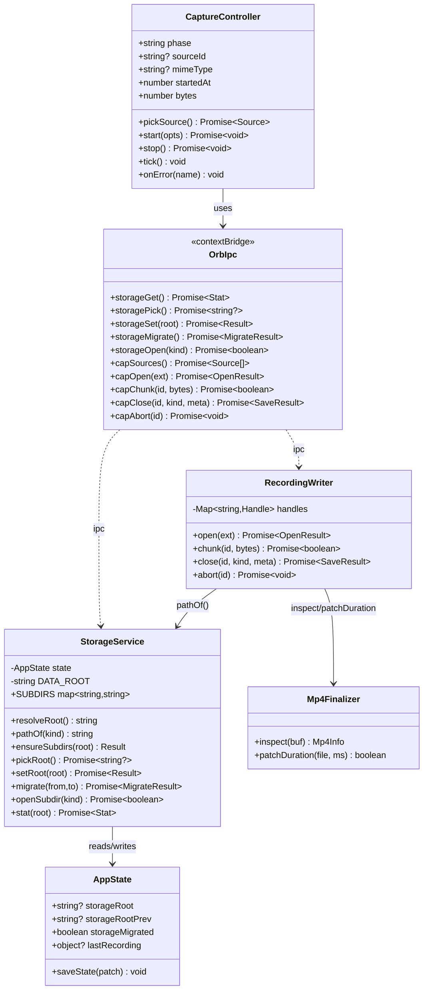
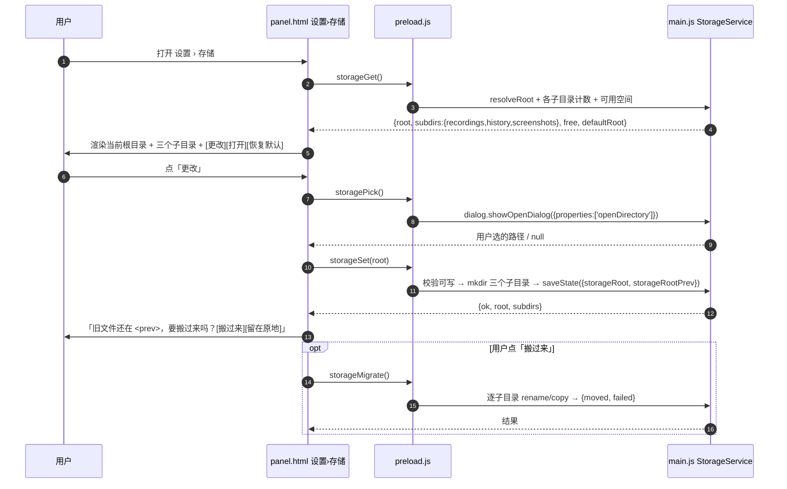
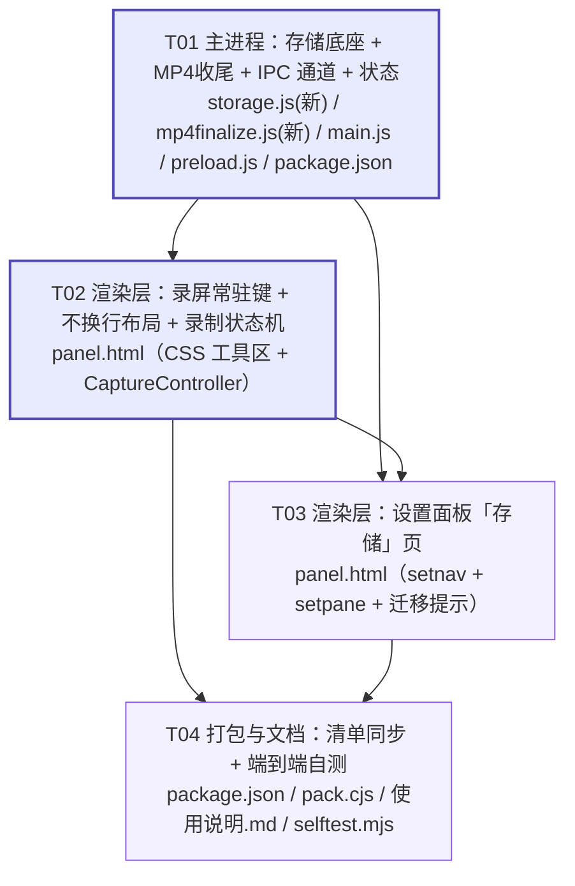

# ORB 控制台 · 增量设计：录屏（MP4）与长期文件存储路径

> 作者：高见远（架构师）　日期：2026-10-20
> 覆盖需求：A 工具栏常驻录屏入口（不换行）／B 录屏产出 MP4、默认落到项目根／C 设置面板可配置长期文件存储根目录
> 运行环境：Windows 10/11 x64，Electron **44.4.5**（Chromium **152.0.7977.130**，Node 24.21.0）

---

## 0. 结论先行（给决策者看的三句话）

1. **MP4 不需要 ffmpeg、不需要自研原生模块** —— Electron 44 内置的 `MediaRecorder` 能直接录出真正的 H.264 MP4。我已在**本机、按 ORB 真实启动参数**实测通过（详见 §1.2 实证数据）。用户明确要的 MP4 是**原生可得**的。
2. **工具栏加第 4 个常驻键，按现有 CSS 一定会换行**（实测需要 399.5px，可用 373px）。解法是 `tight + nowrap` 组合收紧，实测在 1.0/1.1/1.2 三档字号下**都不换行、不溢出**（详见 §2）。
3. **默认目录不要写死 `D:\workbuddy_ORB控制台`** —— 直接复用 main.js 已有的 `DATA_ROOT`：开发态它**就等于**项目根（天然满足需求 B），打包态自动回退到 `%APPDATA%\ORB 控制台`。一行硬编码都不需要。

---

# Part A · 系统设计

## 1. 实现方案与选型

### 1.1 技术难点

| # | 难点 | 处理 |
|---|------|------|
| 1 | Chromium 的 `MediaRecorder` 历史上只出 webm，用户要 MP4 | 实测 Chromium 152 已支持 MP4 muxer + H.264，直接原生出片（§1.2） |
| 2 | 面板跑在 `disable-gpu` + `disableHardwareAcceleration()`，硬件编码器可能不可用 | 实测软件路径仍可出 H.264 MP4；但必须做能力探测 + 降级链 |
| 3 | 渲染层受 CSP + IPC 白名单约束，不能自己写文件 | 采集/编码在渲染层，**落盘全在主进程**，走新增白名单通道分片回传 |
| 4 | 录屏文件可能上百 MB，一次性 structured clone 过 IPC 会爆内存 | 改为**分片流式写入**（`cap-open`/`cap-chunk`/`cap-close`） |
| 5 | 工具栏加键会换行 | 收紧 + `nowrap` + 可收缩，实测验证（§2） |
| 6 | 存储根目录切换后旧文件怎么办 | 默认不自动搬，提供一键搬移（§4.4） |

### 1.2 ★ MP4 方案：实证结论（这是本次唯一必须先查清的风险）

我没有停留在文档记忆，而是**写了一个一次性 Electron 探针，在 `disableHardwareAcceleration()` + `--disable-gpu` + `--disable-gpu-sandbox`（与 `orb/desktop/main.js:10-12` 完全一致）下实测**。探针用完已删除，未污染仓库。

**实测结果：**

| 检查项 | 结果 |
|---|---|
| Electron / Chromium | 44.4.5 / **152.0.7977.130** |
| `isTypeSupported('video/mp4;codecs="avc1.42E01E"')` | **true** |
| `isTypeSupported('video/mp4')` / `'video/mp4;codecs="avc1.640028"'` | **true** |
| 真实编码（canvas 流 1.2s） | **42,854 B**，头 `00 00 00 24 66 74 79 70 69 73 6f 6d` = `…$ftypisom`，`avc1.42001f` |
| 真实编码（**屏幕流 1920×1080@30，3s**） | **91,068 B**，box = `ftyp, moov, moof, mdat, mfra`，`mvhd.duration = 2447ms` ✅ |
| 音频 AAC | `video/mp4;codecs="avc1.42E01E,mp4a.40.2"` → 支持，容器含 `mp4a.40.2` |
| 取源 | `desktopCapturer.getSources({types:['screen']})` → `screen:0:0`「整个屏幕」✅ |
| 取流 | `getUserMedia({chromeMediaSource:'desktop'})` → 1920×1080@30 ✅ |
| 编码器报错 | 无（`onerror` 未触发） |

**结论：Electron 44 直出 MP4/H.264 在本机、在 ORB 的真实启动条件下，端到端可用。**

#### 顺带查清的几个坑（工程师必读）

1. **裸写 `video/mp4` 会掉进 VP9。** 实测 `new MediaRecorder(s, {mimeType:'video/mp4'})` 的 `recorder.mimeType` 被解析成 **`video/mp4;codecs=vp9`**（VP9 装进 MP4 壳，兼容性比 H.264 差很多）。**必须显式写 `avc1`**，不能偷懒只写 `video/mp4`。
2. **codec 串会被规范化降 level。** 请求 `avc1.42E01E` → 实际 `avc1.42001f`；`avc1.640028` → `avc1.64001f`。这是正常的（level 收敛到 3.1），**不要把返回的 `recorder.mimeType` 当成失败去报错**。
3. **产物是分片 MP4（fMP4）**：`ftyp, moov, moof, mdat, …, mfra`。主流播放器（VLC / PotPlayer / Edge / Chrome / Windows 照片/电影和电视）都能放；**实测屏幕录制 `mvhd.duration` 是正确的**（3s 录出 2447ms）。但我在 canvas 场景复现过一次 `duration=0`（无 `mfra`）。因此加一道**收尾校验**（§4.3 `mp4finalize.js`）作为保险：仅在 `mvhd.duration === 0` 时按实测时长回填，平时不动文件。
4. **DXGI 桌面复制偶发失败会自动回落。** 日志里出现过 `DxgiDuplicatorController failed to capture desktop … Duplication failed`，随后 Chromium 自动回落其它采集路径，**仍正常出片**。不要把这个 ERROR 当成失败。
5. **本机 GPU 进程本身是崩的**：探针开启 GPU 时直接 `GPU process exited unexpectedly: exit_code=-1073741819 (0xC0000005)` → `GPU process isn't usable. Goodbye.`。这正是项目 `disable-gpu` 的原因。**所以不要指望 NVENC 等硬件编码**，走软件编码路径即可（已验证可用）。

#### 备选路径逐条取舍（为什么都**不**选）

| 方案 | 结论 | 理由 |
|---|---|---|
| **① MediaRecorder 原生 `video/mp4;codecs="avc1.42E01E"`** | ✅ **采用** | 零新增依赖、零随包体积、实测可用、产物即用户要的 MP4 |
| ② 录 webm → **ffmpeg.exe 转码** | ❌ 否决 | 见下方 ffmpeg 专项结论；且要分发 ~80MB 二进制（GPL/LGPL 合规负担）+ 长时间转码（10min 片要等几分钟），体验差 |
| ③ 自研原生模块（WGC + Media Foundation SinkWriter） | ❌ 本期不做 | 技术可行、能直出 H.264 MP4、性能最好，但约 800~1200 行 C + 新编译脚本 + 每 Electron ABI 重编；在①已验证可用的前提下是纯过度设计。**留作后备**：若将来①在某些机器上大面积失败再启用 |
| ④ WebCodecs `VideoEncoder` + `mp4-muxer` | ❌ 不采用 | 比①多一层手写封装逻辑 + 一个 npm 依赖，收益为 0（①已能给 MP4） |
| ⑤ 录 webm 后**只改扩展名**成 `.mp4` | ❌ **明确不采纳** | 这是欺骗：容器仍是 Matroska/WebM，Windows 资源管理器、剪映、微信、企业微信会按扩展名识别后**解析失败或无法上传**。用户拿到的是坏文件，比给 webm 更糟 |
| ⑥ 用 Electron 自带的 `ffmpeg.dll` 当命令行 | ❌ **不可行**（已核实） | 见下 |

#### ffmpeg.dll 专项核实（team-lead 要求）

**结论：Chromium/Electron 自带的 `ffmpeg.dll` 不能当命令行工具用，也不含编码器。**

- Chromium 使用的是**裁剪过的静态 ffmpeg 子集**（`third_party/ffmpeg/chromium/config/`，`ffmpeg_branding` 决定裁剪范围），构建期就把**编码器、网络协议、muxer 大部分能力裁掉了**，目的正是控制体积 + 规避 GPL。
- 它不导出任何 CLI 入口（`ffmpeg.dll` 里没有 `main`/`avcodec` 的公开命令行符号），**无法 `spawn` 调用**。
- Electron 官方构建的 `proprietary_codecs=true`（Chrome branding）只让**解码/播放**侧支持 H.264/AAC/MP3；**编码**侧 Chromium 走的是平台编码器（Windows = Media Foundation / OpenH264），跟这个 dll 无关。
- 补充：Electron 官方构建默认 `enable_hevc_decoder=false`，HEVC 也别指望。

> 来源：Chromium `third_party/ffmpeg` 裁剪配置与 `USE_PROPRIETARY_CODECS` / `CONFIG_H264_DECODER` 宏；Chromium build 文档 `ffmpeg_branding`；以及本次实测（未替换任何 dll 即出 H.264）。

#### 降级链（仅在极少数机器上触发）

```
① video/mp4;codecs="avc1.42E01E"      首选（Baseline 3.1，兼容性最广）
② video/mp4;codecs="avc1.4D401F"      Main
③ video/mp4;codecs="avc1.640028"      High
④ video/webm;codecs="vp9"             兜底：诚实存成 .webm，UI 明示"本机无 H.264 编码器"
```
每一步都以 `MediaRecorder.isTypeSupported()` 探测；并对 `EncodingError`（`isTypeSupported` 有假阳性，addpipe 大规模实测证实）做**运行时捕获**：若在开始 1s 内无数据且报错，自动降级到下一档重试一次。**绝不把 webm 存成 `.mp4`**。

---

## 2. ★ 工具栏「不换行」的具体做法（实测数据支撑）

### 2.1 现状

- `orb/desktop/main.js:199` → `const PANEL_W = 400`
- `panel.html:1207-1211` → `.tools { padding: 8px 13px 4px }`，`.tools-row { display:flex; gap:5px; **flex-wrap: wrap** }`
- 当前常驻：`TIER_PINNED = ['Snapshot','RTSUB','CursorPos']`（`panel.html:3778`）= 看屏幕 / 实时字幕 / 鼠标位置，外加「更多」入口
- 工具行**可用宽度 = 400 − 26 = 373px**

### 2.2 实测（Electron 内真实渲染，Microsoft YaHei）

| 方案 | 加录屏键 | 字号 1.0 | 字号 1.1 | 字号 1.2 |
|---|---|---|---|---|
| baseline（现状 CSS） | 否 | 需 333.2 / 换行 0 | 349.3 / 0 | 365.5 / 0 |
| **baseline（现状 CSS）** | **是** | **需 399.5 / 换行 1 ❌** | **418.0 / 1 ❌** | **436.5 / 1 ❌** |
| 仅 `nowrap` | 是 | 不换行但 **scroll 399 > 373，溢出 ❌** | 418 溢出 | 436 溢出 |
| 仅 `tight`（收紧） | 是 | 359.2 / 0 ✅ | 376.4 / 0 ✅ | 393.7 / **换行 1 ❌** |
| **`tight` + `nowrap`（采用）** | **是** | **359.2 / 换行 0 / scroll=373 ✅** | **376.4→收缩后 / 0 / scroll=373 ✅** | **393.7→收缩后 376.7 / 0 / scroll=373 ✅** |

> 说明：`tight` 单独用仍继承 `flex-wrap:wrap`，字号放大到 1.2 仍会换行 —— **必须 `nowrap` 与收紧同时生效**。`scroll === client` 表示既不换行也不溢出。

### 2.3 落地做法（可直接照抄）

**① 给工具行加专属类名**，避免误伤复用 `.tools-row` 的其它地方
> ⚠️ **`#fontPick`（`panel.html:2160`，设置 › 外观 › 文字 › 字号）也用了 `class="tools-row"`。** 若直接改 `.tools-row`，字号那一行会被波及。因此新增规则**必须限定在新类名 `.pinnedrow` 下**，`buildTools()` 里 `row.className` 从 `'tools-row'` 改为 `'tools-row pinnedrow'`。

**② CSS**（放在 `panel.html` 工具区样式段，紧邻现有 `.tools-row` / `.pinned`）

```css
/* 常驻行：第 4 个键（录屏）进来后必须仍是一行。
   实测：baseline 需 399.5px > 可用 373px 会换行；收紧 + nowrap 后
   字号 1.0/1.1/1.2 三档均 scroll === client（不换行、不溢出）。 */
.tools-row.pinnedrow { flex-wrap: nowrap; gap: 4px; }
.tools-row.pinnedrow .pinned {
  flex: 0 1 auto; min-width: 0;      /* 允许在极端字号下收缩，而不是把「更多」挤出去 */
  gap: 4px; padding: 0 7px 0 6px;    /* 原 0 9px 0 7px */
}
.tools-row.pinnedrow .pinned svg { width: 15px; height: 15px; }  /* 原 16px */
.tools-row.pinnedrow .pinned span {
  min-width: 0; overflow: hidden; text-overflow: ellipsis;       /* 收缩时省略号，不截断图标 */
}
.tools-row.pinnedrow .more-btn { flex: 0 0 auto; padding: 0 8px; } /* 「更多」永不收缩 */
.tools-row.pinnedrow .more-btn b { display: none; }               /* 极窄时才隐藏数量角标 */
```

**③ 运行时兜底**（防止未来又加键 / 用户字号更大）：
```js
// buildTools() 末尾
if (row.scrollWidth > row.clientWidth + 1) row.classList.add('tight');
// .tight 再降一档：gap:3px、.pinned padding:0 5px 0 5px
```

### 2.4 图标与动效（遵守既有约定）

**图标**：内联 SVG，与工具栏同一套 `ICO()` 规范（24×24 / `stroke="currentColor"` / `stroke-width="2"` / `fill="none"`），走 `TOOL_ICONS`。
已有现成的录制图标（`panel.html:3825`，实心圆点）可直接复用：

```js
Record: '<svg viewBox="0 0 24 24" fill="none" stroke="currentColor" stroke-width="2" stroke-linecap="round" stroke-linejoin="round"><circle cx="12" cy="12" r="8.6"/><circle cx="12" cy="12" r="3.6" fill="currentColor" stroke="none"/></svg>',
```
新键用**这个图形 + 文案「录屏」**（与「实时字幕」「鼠标位置」等长文案风格一致）。

**动效**：录制中用 `.on` 类驱动，**只动 `transform` / `opacity`**：

```css
/* 录屏键：录制中反色 + 红点呼吸。只动 opacity/transform，时长走 --dur-1/2 */
.pinned.cap-on { color: #fff; background: #D8443F; border-color: #D8443F; }
.pinned.cap-on .capdot { animation: cappulse 1.2s var(--ease) infinite; }
@keyframes cappulse { 0%,100% { opacity: 1; transform: scale(1) } 50% { opacity: .35; transform: scale(.82) } }
/* 入场：只用 backwards，不用 both（both 会锁死 transform 让 hover 失效） */
.pinned.cap { animation: capin var(--dur-2) var(--ease) backwards; }
@keyframes capin { from { opacity: 0; transform: translateY(-3px) scale(.96) } to { opacity: 1; transform: none } }
@media (prefers-reduced-motion: reduce) { .pinned.cap-on .capdot, .pinned.cap { animation: none } }
```
并追加到 `html.no-motion` 兜底列表（现有列表在 `panel.html:639-651`）。

**颜色**：只用 `--accent` / `--accent-soft` / `--accent-fg`；录制中的红沿用急停那套 `#D8443F`（已在 `.pinned.danger` 里用过，非 `--energy*`）。**禁用 `--energy*`**（t3 未定义会变透明）。**不用 `backdrop-filter`**。

### 2.5 ⚠️ 一个必须避开的命名冲突

`setRecUi()`（`panel.html:5380`）会去查 `#toolRec` 并把它当**工作流录制**键改文案（`'停止'`/`'录制'`）。
→ 新的录屏键 **不能叫 `toolRec`**，用 **`id="toolCap"`**。否则录屏时工作流录制状态会误改这个键。

---

## 3. 文件列表

| 文件 | 类型 | 改动要点 |
|---|---|---|
| `orb/desktop/storage.js` | **新增** | 主进程存储服务：根目录解析、子目录创建、选择/校验、迁移、打开子目录 |
| `orb/desktop/mp4finalize.js` | **新增** | 主进程 MP4 收尾校验：`mvhd.duration === 0` 时按实测时长回填（保险，通常不动文件） |
| `orb/desktop/main.js` | 改 | `require` 两个新模块；`state` 增字段；新增 8 个 `safeHandle` 通道；`history-load/save` 改走 storage |
| `orb/desktop/preload.js` | 改 | contextBridge 白名单增 8 个通道（**不暴露 fs / shell / 通用 invoke**） |
| `orb/desktop/panel.html` | 改 | ① 工具区：`.pinnedrow` CSS + 录屏常驻键 + 图标 + 动效 ② 录屏状态机与采集编码 ③ 设置面板新增「存储」页 |
| `orb/desktop/package.json` | 改 | `build.files` 增 `storage.js`、`mp4finalize.js`（**否则打包后缺失，运行时 require 失败**） |
| `orb/pack.cjs` | 改（小） | 确认新增文件随包；便携目录说明若提及目录结构需同步 |
| `使用说明.md` | 改（小） | 补「录屏」与「存储位置」两节 |

> 不新增窗口/新 HTML：录屏复用面板渲染层（面板常驻，采集的是屏幕不是面板自身）。保持"单文件渲染层"既有性质。

---

## 4. 数据结构与接口

### 4.1 类图



### 4.2 关键接口约定

**存储根目录解析（不硬编码，天然满足需求 B）**
```
resolveRoot():
  r = state.storageRoot
  if r && isAbsolute(r) && exists(r) && writable(r): return r
  return DATA_ROOT          // 开发态 = 项目根(D:\workbuddy_ORB控制台)；打包态 = %APPDATA%\ORB 控制台
```
> 开发态 `DATA_ROOT = path.join(__dirname,'..','..')` = `D:\workbuddy_ORB控制台`，**正好就是用户要的默认目录**，无需写死。

**子目录（`storage.js` 常量）**
```
SUBDIRS = { recordings: 'recordings', history: 'history', screenshots: 'screenshots' }
```
`pathOf('recordings') = join(resolveRoot(),'recordings')`。**选了根目录后自动建这三个子目录，不平铺。**

**文件名**
- 录屏：`录屏-YYYYMMDD-HHmmss.mp4`（冲突时追加 `-2`）
- 截屏：`截屏-YYYYMMDD-HHmmss.png`
- 历史：`history/conversations.json`（沿用现有，仅改根目录）

**新增 state 字段（`orb-state.json`）**
```jsonc
{
  "storageRoot": null,        // null = 用 DATA_ROOT
  "storageRootPrev": null,    // 上一次的根，供"搬到新位置"用
  "lastRecording": { "path": "", "bytes": 0, "ms": 0, "mime": "" }
}
```

**录屏状态机（渲染层 `CaptureController.phase`）**
```
idle → preparing → recording → finalizing → saved
                             ↘ error
```

### 4.3 MP4 收尾校验（`mp4finalize.js`）

```
inspect(buf) -> { ok, hasFtyp, hasMoov, isFragmented, durationMs }
patchDuration(file, ms) -> boolean     // 仅当 mvhd.duration === 0 时调用
```
- 只改 `moov/mvhd`（及 `trak/tkhd`、`mdhd`）里的时长字段，**字段长度不变 → 不需要修任何 offset**，安全性高。
- 平时返回 `{ok:true, skipped:true}`，不动文件。

### 4.4 迁移策略（切换根目录时）

**默认：不自动搬移。** 切换后：
1. 在新根下建齐三个子目录；
2. 面板提示：`已切换到 <新路径>。旧文件仍在 <旧路径>。[搬过来] [留在原地]`；
3. 点「搬过来」→ `storage-migrate`：按子目录逐个搬（`fs.renameSync` 优先，跨卷 `EXDEV` 时 copy+unlink），返回 `{moved, failed, skipped}`；失败的文件**保留在旧位置**并列出，绝不静默丢弃。

> 理由：录屏文件动辄百 MB，静默自动搬移会造成长时间无反馈、中断易产生半截文件。显式询问更安全。此策略为建议，待 team-lead 拍板（§9）。

---

## 5. 程序调用流程

### 5.1 点「录屏」→ MP4 落盘（完整链路）

```mermaid
sequenceDiagram
    autonumber
    participant U as 用户
    participant P as panel.html<br/>CaptureController
    participant B as preload.js<br/>window.orb
    participant S as main.js<br/>StorageService
    participant W as main.js<br/>RecordingWriter
    participant F as mp4finalize.js

    U->>P: 点「录屏」常驻键
    P->>P: phase=preparing，键加 .cap-on（红点呼吸）
    P->>B: capSources()
    B->>S: desktopCapturer.getSources({screen,window})
    S-->>P: [{id:'screen:0:0',name:'整个屏幕'}]
    P->>P: 探测 isTypeSupported(候选链) → 'video/mp4;codecs="avc1.42E01E"'
    P->>P: getUserMedia({chromeMediaSource:'desktop'}) → MediaStream 1920x1080@30
    P->>B: capOpen('mp4')
    B->>W: 建临时写句柄 <storageRoot>/recordings/.tmp/xxx.part
    W-->>P: {ok, id}
    P->>P: new MediaRecorder(stream,{mimeType, videoBitsPerSecond:4e6}); start(1000)
    P->>P: phase=recording，键上显示计时 mm:ss

    loop 每 1s（MediaRecorder timeslice）
        P->>B: capChunk(id, ArrayBuffer)
        B->>W: append 到 .part
        W-->>P: {ok}
    end

    U->>P: 再点一次（停止）
    P->>P: recorder.stop() → phase=finalizing
    P->>B: capClose(id,'recordings',{ms,mime})
    B->>W: 收尾
    W->>S: pathOf('recordings')
    S-->>W: <root>/recordings
    W->>W: rename .part → 录屏-YYYYMMDD-HHmmss.mp4
    W->>F: inspect(buf)
    F-->>W: {durationMs}
    alt durationMs === 0（罕见）
        W->>F: patchDuration(file, 实测ms)
    end
    W-->>P: {ok, path, bytes, ms}
    P->>P: phase=saved，去掉 .cap-on
    P->>U: 气泡「已保存到 <path>（xx MB / mm:ss）[打开文件夹][复制路径]」
```

### 5.2 设置面板改存储根目录



---

## 6. 待明确事项（请 team-lead 拍板）

| # | 问题 | 我的建议 |
|---|---|---|
| 1 | **切换根目录时是否自动搬移旧文件？** | 不自动搬，提示 + 一键搬移（§4.4）。若你希望"无脑自动"，我改成自动但加进度条 |
| 2 | **录屏默认参数**：分辨率/帧率/码率？是否录系统声音/麦克风？ | 默认 1080p / 30fps / 4 Mbps / **不录音频**（录音频需额外授权且 AAC 会增加复杂度）。是否要音频请拍板 |
| 3 | **录屏时是否自动隐藏 ORB 面板自身**？ | 建议**不隐藏**（面板小且常驻，隐藏反而丢失录制状态反馈）。`orb.getBounds()` 已预留"录制时排除自身窗口"能力，若要做画中画遮挡排除可启用 |
| 4 | **录屏范围**：整屏 / 单窗口 / 区域框选？ | 本期只做**整屏 + 可选单窗口**（`desktopCapturer` 两者都返回）。区域框选需新交互，建议下期 |
| 5 | **录屏最长时长**？ | 建议软上限 30 分钟，到点提示（避免误触忘停写满磁盘）。或不做限制 |
| 6 | **顶栏那枚「录制」（工作流录制）要不要改名**？ | 建议改名为「录操作」/ tooltip 明确"录制工作流（非录屏）"，与新「录屏」区分，避免用户混淆 |
| 7 | 设置面板「存储」页的**图标与位置** | 建议插入 `setnav` 中「通道」之后、「关于」之前（第 6 个），图标用文件夹/硬盘图形 |

---

# Part B · 任务分解

## 7. 依赖包 / 外部组件清单

**结论：本次零新增第三方依赖。** 这是本方案最大的优势。

| 项 | 是否引入 | 说明 |
|---|---|---|
| ffmpeg（任何形式） | ❌ 不引入 | 内置 ffmpeg.dll 不可用（§1.2）；外部 ffmpeg.exe 有体积 + 许可负担，本机实测不需要 |
| 原生 C 模块（WGC/MediaFoundation） | ❌ 本期不引入 | 后备方案，见 §1.2 ③ |
| `mp4-muxer` / `mp4box.js` | ❌ 不引入 | 原生 MP4 已够用 |
| npm 包 | ❌ 无 | — |
| 系统能力 | ✅ 使用 | `desktopCapturer`、`dialog`、`shell.openPath`（Electron 内置） |

若将来要启用 ffmpeg 后备，注意：含 `libx264` 的构建是 **GPL**，与本项目 MIT 并存需履行 GPL 分发义务；**LGPL 构建通常不含 x264**，无法出 H.264 —— 这是分发 ffmpeg 的实际合规难点，也是不选它的次要理由。

## 8. 任务列表（按依赖顺序）

### T01 · 主进程：存储底座 + IPC 通道 + 状态持久化　`P0`

- **文件**：`orb/desktop/storage.js`（新）、`orb/desktop/mp4finalize.js`（新）、`orb/desktop/main.js`、`orb/desktop/preload.js`、`orb/desktop/package.json`
- **依赖**：无
- **内容**：
  - `storage.js`：`resolveRoot()` / `pathOf(kind)` / `ensureSubdirs()` / `stat()` / `setRoot()` / `migrate()` / `openSubdir()`；`SUBDIRS` 常量
  - `mp4finalize.js`：`inspect(buf)` / `patchDuration(file, ms)`
  - `main.js`：`require` 两模块；`state` 增加 `storageRoot` / `storageRootPrev` / `lastRecording`；8 个 `safeHandle`：`storage-get` / `storage-pick` / `storage-set` / `storage-migrate` / `storage-open`、`cap-sources` / `cap-open` / `cap-chunk` / `cap-close` / `cap-abort`；`history-load` / `history-save` 改走 `storage.pathOf('history')`
  - `preload.js`：contextBridge 增对应 8 个通道（**禁止暴露 fs/shell/通用 invoke**）
  - `package.json`：`build.files` 增 `storage.js`、`mp4finalize.js`
- **验收**：改 `orb-state.json` 的 `storageRoot` 后重启生效；三个子目录自动创建；`history` 落在新根下

### T02 · 渲染层：录屏入口 + 不换行布局 + 录制状态机　`P0`

- **文件**：`orb/desktop/panel.html`
- **依赖**：T01
- **内容**：
  - CSS：新增 `.tools-row.pinnedrow` 收紧 + `nowrap` 规则（§2.3 照抄），`.pinned.cap-on` 红点呼吸 + 入场动效，`prefers-reduced-motion` / `html.no-motion` 兜底
  - `buildTools()`：`pinnedOrder` 加入 `'RecordCap'`（**id 用 `toolCap`，不要 `toolRec`**），`row.className` 改 `'tools-row pinnedrow'`，末尾加 `scrollWidth > clientWidth` 兜底
  - `TOOL_ICONS` 复用现有录制图；新增 `CaptureController`：能力探测链、降级、`getUserMedia(chromeMediaSource:'desktop')`、`MediaRecorder(mimeType:'video/mp4;codecs="avc1.42E01E"', videoBitsPerSecond:4e6)`、`start(1000)` 分片回传、计时 UI、气泡「已保存 / [打开文件夹]」
  - 与 `withHold()`（`panel.html:4041`）配合，录制中保持面板不折叠
- **验收**：400px 窗口下工具行**不换行、不溢出**（`scrollWidth === clientWidth`）；三档字号均不换行；产出的文件 `ftyp` 开头、能在系统播放器打开

### T03 · 渲染层：设置面板「存储」页　`P1`

- **文件**：`orb/desktop/panel.html`
- **依赖**：T01、T02（**与 T02 同文件，必须串行或同一工程师**，避免冲突）
- **内容**：
  - `setnav` 增「存储」按钮（建议放在「通道」后、「关于」前，图标 24×24 currentColor）
  - 新增 `<div class="setpane" data-pane="storage">`：当前根目录、三个子目录及文件数、可用空间、[更改] [打开] [恢复默认]
  - 切换后的旧文件提示条 + [搬过来] / [留在原地]
  - 主题令牌只用 `--accent*` 与中性色；禁用 `--energy*`；无 `backdrop-filter`
- **验收**：切换目录后子目录自动建立并持久；重启后生效；「打开」能打开对应子目录

### T04 · 打包与文档：清单同步 + 端到端自测　`P1`

- **文件**：`orb/desktop/package.json`、`orb/pack.cjs`、`使用说明.md`、`orb/selftest.mjs`
- **依赖**：T01、T02、T03
- **内容**：
  - 确认 `storage.js` / `mp4finalize.js` 随包（便携目录 + zip + 自解压 exe 三种产物都要验）
  - 打包态回归：确认默认根目录回退到 `%APPDATA%\ORB 控制台`，**不出现任何开发机绝对路径**
  - `使用说明.md` 补「录屏」与「存储位置」两节
  - `selftest.mjs` 加一条：录 2 秒 → 校验产物 `ftyp` 与时长 > 0
- **验收**：打包产物解压后双击可录屏、MP4 正常播放、存储目录正确

## 9. 共享知识（跨文件约定，工程师必读）

**1) 新增 IPC 通道名（全小写中划线，与现有风格一致）**
```
storage-get / storage-pick / storage-set / storage-migrate / storage-open
cap-sources / cap-open / cap-chunk / cap-close / cap-abort
```
全部用 `safeHandle(channel, fn, fallback)`（`main.js:157`）实现，preload 侧逐个显式暴露。

**2) 状态字段命名**：`storageRoot` / `storageRootPrev` / `lastRecording`，走 `saveState({...})` 落 `orb-state.json`。

**3) 目录约定**：`<root>/recordings`、`<root>/history`、`<root>/screenshots`。临时文件写 `<root>/recordings/.tmp/*.part`，成功后 rename。

**4) 路径泛化铁律**：任何地方**不得出现** `D:\workbuddy_ORB控制台` 字面量。需要默认目录就用 `DATA_ROOT`（`main.js:29`）。

**5) MIME 铁律**：录屏必须显式 `video/mp4;codecs="avc1.42E01E"`。**禁止只写 `video/mp4`**（会变 VP9）。**禁止把 webm 存成 `.mp4`**。

**6) 主题铁律**：共用样式只用 `--accent` / `--accent-soft` / `--accent-fg` + 中性色（`--bg*` / `--fg*` / `--border*`）。**禁用 `--energy*`**。录制红沿用 `#D8443F`（急停同色）。**禁用 `backdrop-filter`**。

**7) 动效铁律**：只动 `transform` / `opacity`；`--dur-1/2/3` + `--ease`；`animation-fill-mode: backwards`（**不用 `both`**，会锁 transform 导致 hover 失效）；补 `prefers-reduced-motion` 与 `html.no-motion`。

**8) CSS 作用域铁律**：新增工具行样式**必须限定在 `.tools-row.pinnedrow` 下** —— `#fontPick` 也复用 `.tools-row`，直接改基类会误伤设置面板字号行。

**9) 命名避坑**：新录屏键 `id="toolCap"`，**不要 `toolRec`**（`setRecUi()` 会把它当工作流录制键改文案）。

**10) 已知噪音日志**：`DxgiDuplicatorController failed to capture desktop … Duplication failed` 是 Chromium 采集路径回落，**不影响出片**，不要当错误处理。

## 10. 任务依赖图



> T02 与 T03 都改 `panel.html`，存在同文件冲突：**串行执行或交同一工程师**。

## 11. T05 悬浮录屏控制条（2026-10-21 追加，用户需求）

**需求原文**：「开始录制时，对标市面主流录屏软件，应至少有暂停和开始，取消，完成按键，为他们设置合适的图标和动效。」
录制开始后面板自动隐藏（既有拍板），因此控制键不能放在面板内，必须落在独立悬浮窗口上。

### 11.1 组件

| 文件 | 归属 | 内容 |
|---|---|---|
| `orb/desktop/recbar.html`（新） | 主进程工程师 | frameless alwaysOnTop 320×64 顶部居中可拖拽悬浮条：红点 + mm:ss 计时 + 暂停/继续（toggle）、取消、完成三个图标钮 |
| `orb/desktop/recbar-preload.js`（新） | 主进程工程师 | contextBridge 仅暴露 `sendBarCmd` / `onRecEvent` |
| `panel.html` `CaptureController` | 渲染层工程师 | 新增 `paused` 态 + `pause()/resume()/abort()` + `onRecCmd` 路由 + 各阶段 `recBarEvent` |

### 11.2 IPC 契约（双方禁止改名）

```
panel → main : rec-cmd-to-bar  {type:'start'|'pause'|'resume'|'stop'}
bar   → main : rec-bar-cmd     'pause'|'resume'|'finish'|'abort'
main  → panel: rec:cmd         'pause'|'resume'|'finish'|'abort'
main  → bar  : rec:event       {type:'start'|'pause'|'resume'|'stop'}
```

- **计时器必须跑在 recbar 自己身上**：面板隐藏/关闭后 Chromium 会节流渲染进程定时器，面板计时不可托付。
- recbar 懒创建 + `pendingRecEvents` 队列（`did-finish-load` 后 flush），创建失败只记日志不阻断录制。
- 面板窗口 `closed` 时隐藏 recbar，并按录制态清理 `recordings/*.part`（只删 .part，不碰成品 mp4）。
- 面板可见性仍归 `panel.html`（既有 `hideTimer → closePanel` / `restorePanel`），主进程只管 recbar 显隐与转发。

### 11.3 视觉与动效

- 图标：暂停=双竖条；继续=实心三角；取消=X；完成=勾（`currentColor` 描边/填充，形状见工程师任务书）。
- 配色：t1 深色 pill（`--bg #12162b` 系 / `--border` / `--fg #e8eaf6` 系）；完成 hover 用 t1 `--ok`；取消 hover 用 `#D8443F`；**禁 `--energy*`、禁 `backdrop-filter`**（recbar 不属于任何主题）。
- 动效：只 `transform`/`opacity`；`--dur-*` + `--ease`；`animation-fill-mode: backwards`；`prefers-reduced-motion` + `html.no-motion` 双兜底。红点 opacity 0.35↔1 闪烁（暂停停闪压暗）；按钮入场 translateY(6px)→0 + opacity，40ms stagger；hover translateY(-1px)；active scale(0.94)。

### 11.4 边界行为

- 暂停态允许直接「完成」：`MediaRecorder.stop()` 在 paused 下合法；`durationMs` 含暂停时长（MediaRecorder 暂停不出帧，成片真实时长天然不含暂停，秒级差异可接受，**不伪造 durationMs**）。
- 取消（abort）不复用 `stop()` 的 catch 分支（避免误报「保存失败」），独立走 idle + sys 消息。
- recorder.onerror / 系统共享条被用户停止 → 有 chunk 走 stop()，零 chunk 走 abort()；任何异常出口必发 `recBarEvent('stop')`。
- 工具行 `#toolCap` 的 toggle 保底保留（开始/停止仍可用），悬浮条是新增入口不是唯一入口。

