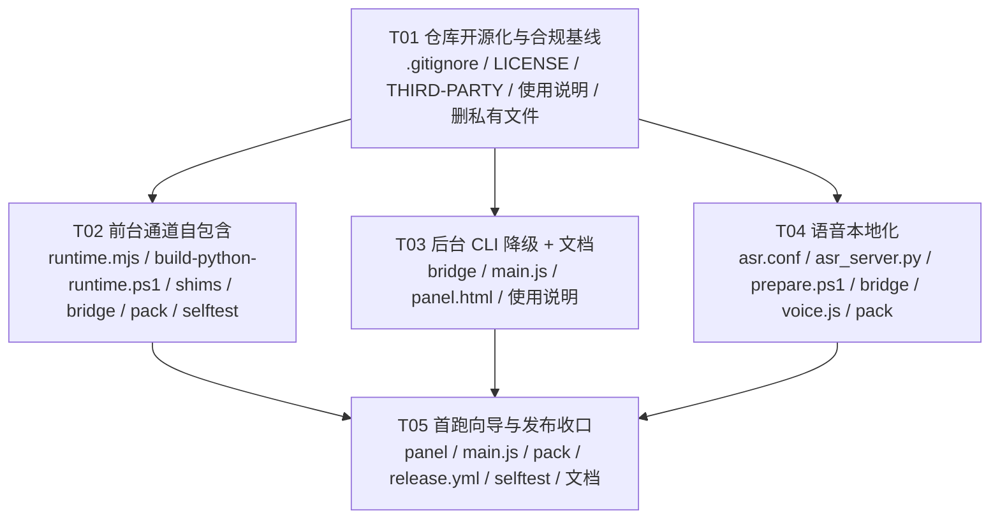
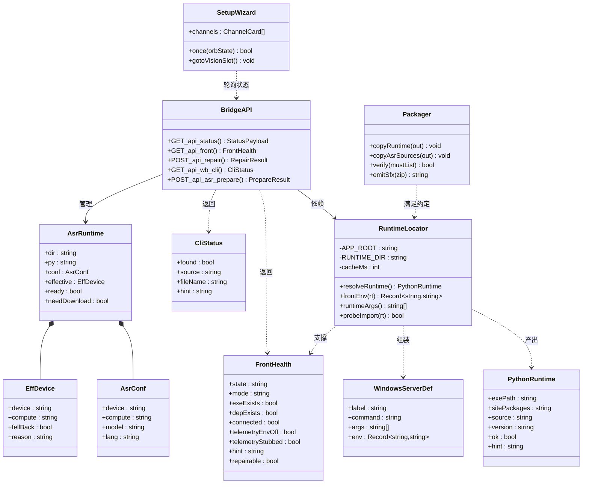
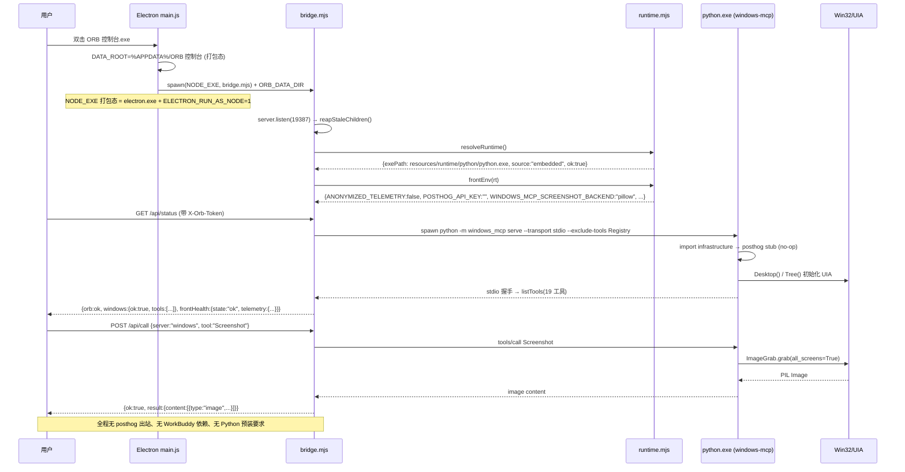
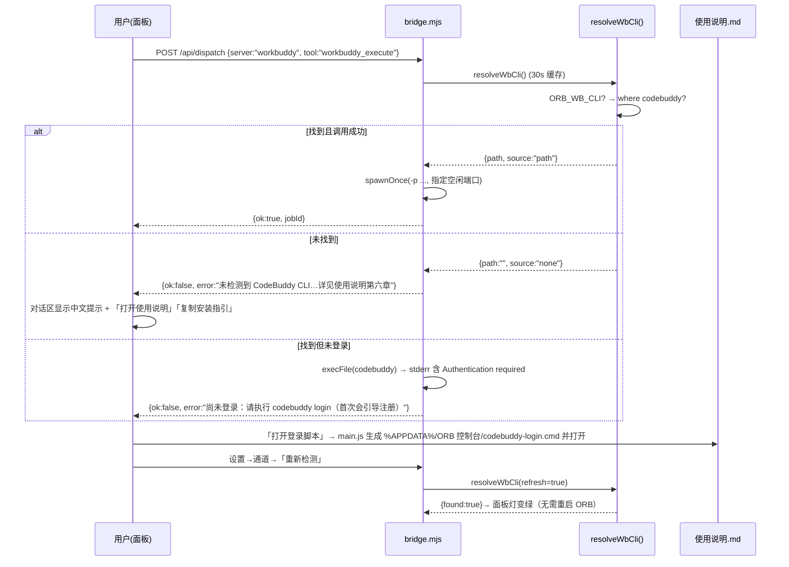
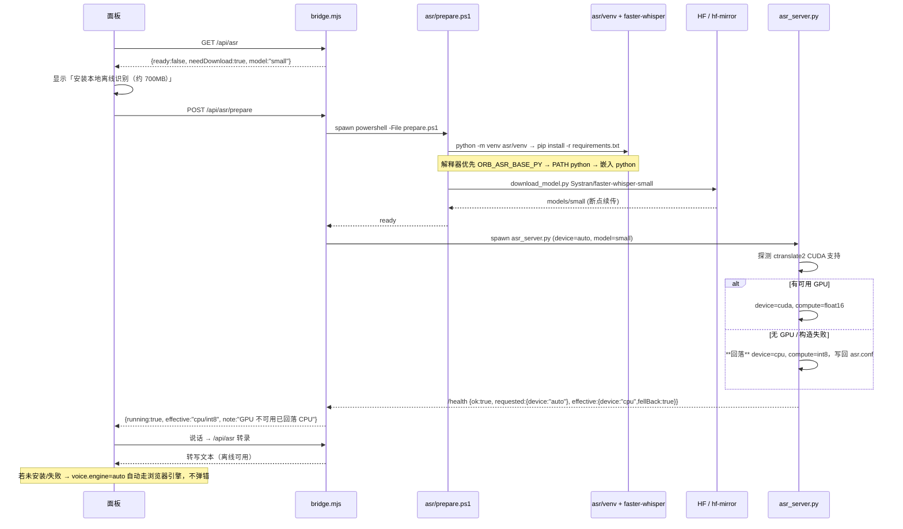

# ORB 控制台 · 开箱即用增量设计

> 版本：v2　作者：架构师（高见远）　日期：2026-10-14
> 定位：**只做设计，不改代码**。所有结论均已对照本机源码 / 依赖元数据核实，行号以当前工作副本为准。
> 目标：让 GitHub 上下载本程序的人，本地打开后**立即可用**；同时满足 **MIT 开源、不侵权、不引入纠纷**。
> v2 变更：按主理人 2026-10-14 的实测更正处理了三件事 —— ① 路线 B 由"中期备选"改为**近期不可行/长期技术储备**（§2 B）；② PostHog 关闭改为 **`POSTHOG_API_KEY=""` 零改动优先**（§3.1）；③ 补齐**干净依赖集构建清单**并指出 `pip install windows-mcp` 会把 GPL 拉回来的关键陷阱（附录 A）。差异对照见附录 B。

---

## 0. 结论速览（先给决策）

| 议题 | 结论 |
|---|---|
| 自研替代 windows-mcp？ | **不可行（近期）**。自查 14 个能力组，自研三件套只覆盖 2~3 个且是子集；快照/UIA 树/截图/元素匹配/虚拟桌面全部为零。已降级为**长期技术储备**，不立项（§2 B） |
| 前台通道自包含 | **推荐路线 A1**：把 **PSF 嵌入版 Python + 精简依赖集**随包发布，改为 `python -m windows_mcp serve` 启动；不再依赖 `~/.workbuddy`，机器上没有 Python 也能起来。**这才是本次命题：不是干掉 windows-mcp，而是把它合规地打包分发清楚** |
| GPL 风险 | `fuzzywuzzy(GPLv2)` / `python-Levenshtein(GPL-2.0-or-later)` **不进包**，改用 `thefuzz(MIT) + rapidfuzz(MIT)` + 一个自写的 `fuzzywuzzy` 转发壳。**⚠️ 关键：`pip install windows-mcp` 会按其 Requires-Dist 把这两个 GPL 拉回来，必须 `--no-deps` + 自建 pin 清单**（附录 A.0） |
| 遥测风险 | **零改动首选**：拉子进程时传 `POSTHOG_API_KEY=""`（键存在、值为空 → 取不到硬编码 Key → 跳过初始化）；主闸用 `ANONYMIZED_TELEMETRY=false`（非空值、语义无歧义）。是否再上 no-op `posthog` stub 作为可选加固见 §11 Q7 |
| 体积代价 | 当前单文件 exe **165 MB** → 预计 **≈ 300 MB**（嵌入 Python ~25 MB + 精简依赖集 ~110 MB），用 pillow 截图后端砍掉 numpy/dxcam 55 MB |
| 后台通道 | 检测 PATH / `ORB_WB_CLI`，缺失时**不崩、给可操作中文提示**并指向 `使用说明.md` 的「安装与登录/注册」章节 |
| 语音 | 默认引擎改 `auto`：**优先本地 Whisper，不可用自动回退浏览器内置**；本地 Whisper 走用户端一键安装（venv + small 权重），不进发布物；`device: auto`，无 GPU 自动回落 CPU |
| 视觉 | 必须用户一次性填自己的 Key（算力成本在用户侧，无法代付）——首跑向导直达 |
| 任务规模 | 5 个任务组（T01…T05），详见第 9 节 |

**一句话**：前台/原生/编排三条本地能力做到**真·零配置**；语音默认零配置（浏览器引擎）、离线增强可选；视觉与后台**必须**用户一次性配置——这不是工程没做够，而是算力与专有软件不能代分发。

---

## 1. 现状核实（后续设计都扣这些事实）

### 1.1 代码侧事实表

| 位置 | 现状 | 影响 |
|---|---|---|
| `orb/bridge.mjs:96` | `VENV_DIR = pickFirst("binaries/python/envs/default","ORB_VENV")` | 硬绑 WorkBuddy 家目录；没装 WorkBuddy 就没有 python |
| `orb/bridge.mjs:98-107` | `resolveBasePy()` 扫 `~/.workbuddy/binaries/python/versions` | 同上，且兜底写死 `C:\Users\%USERNAME%\...` |
| `orb/bridge.mjs:112-113` | `WINDOWS_MCP = VENV_DIR/Scripts/windows-mcp.exe` | **依赖 venv 的控制台入口脚本** |
| `orb/bridge.mjs:124-127` | `WORKBUDDY_CLI` 兜底 `D:\orb-tools\codebuddy-cli\codebuddy.exe` | 开源即暴露私有路径且必失效 |
| `orb/bridge.mjs:603-630` | `SERVERS.windows = {command: WINDOWS_MCP, args:["serve","--transport","stdio","--exclude-tools","Registry"]}` | 无 `env` 字段 → 无法注入遥测开关 |
| `orb/bridge.mjs:694-701` | `KIND_IMAGES.windows = ["windows-mcp.exe"]` | 改成 `python -m` 启动后**进程名会变成 python.exe**，孤儿回收逻辑失效/误杀 ASR（见 §4.5） |
| `orb/bridge.mjs:1868-1877` | `ASR_DIR=HERE/..asr`、`ASR_PY=asr/venv/Scripts/python.exe` | `pack.cjs` 根本没打包 `asr/`，打包态 ASR 必废 |
| `orb/bridge.mjs:2946` | `if (ASR_AUTOSTART && existsSync(ASR_CONF))` 才自启 | 随包不带 `asr.conf` → 语音永远不自启 |
| `orb/pack.cjs:11` | 注释写明 asr 不打进包 | 同上 |
| `orb/pack.cjs:17` | `ROOT='D:/workbuddy_ORB控制台'` 硬编码 | 换机器无法构建（应在任务 T05 参数化） |
| `orb/desktop/main.js:30-32` | `DATA_ROOT = isPackaged ? %APPDATA%/ORB 控制台 : 项目根` | 正确，可写入口已具备 |
| `orb/desktop/main.js:68-83` | `resolveNodeExe()` 打包态兜底 `process.execPath` + `ELECTRON_RUN_AS_NODE=1` | **可直接复用这套思路给 Python 运行时定位** |
| `orb/desktop/main.js:261-267` | `voice.engine = "browser"` | 当前默认已是浏览器；改为 `auto` |
| `asr/asr.conf` | `{"device":"cuda","compute":"int8_float16"}` | 无 GPU 机器必炸 |
| `asr/asr_server.py:60` | `_JUNC_BASE = Path(r"D:\orb-asr\models")` | 开发机私有路径，必须去掉 |
| `asr/asr_server.py:152-157` | import ceneler: fastapi / faster_whisper / uvicorn | 走用户端运行时安装（含 `av`→FFmpeg，见风险清单 R3） |

### 1.2 依赖侧事实表（本机 venv 实测）

| 包 / 版本 | 许可证 | 处置 |
|---|---|---|
| `windows-mcp 0.8.5` | **MIT** | ✅ 随包，附作者 MIT 声明 |
| `fuzzywuzzy 0.18.0` | **GPLv2** | ❌ 剔除，用 `thefuzz 0.22.1 (MIT)` + 转发壳顶替（`desktop/service.py:23` 硬 import） |
| `python-Levenshtein / levenshtein 0.27.5` | **GPL-2.0-or-later** | ❌ 剔除（仅是加速器，`rapidfuzz` 已承担） |
| `posthog 7.67.0` | MIT（但**第三方遥测**） | ❌ 不随包，用自写 stub 顶替 import |
| `certifi 2026.7.22` | **MPL-2.0（文件级弱 copyleft）** | ⚠️ 随包但在 `THIRD-PARTY-NOTICES.md` 单列，保持文件原样不改 |
| `numpy 34MB + numpy.libs 21MB`、`dxcam 3MB` | MIT / MIT | ❌ 剔除，改用 **pillow 截图后端**（后端 registry 已内置 `pillow`，且 dxcam 属**懒加载**，见下） |
| `pygments / pywin32 / requests / fastmcp / comtypes / pillow / psutil / markdownify / tabulate / platformdirs / uuid7 / rich / cyclopts / authlib …` | Apache-2.0 / PSF / BSD / MIT | ✅ 随包 |
| `pip / pythonwin / PyWin32.chm` | MIT / PSF | ❌ 剔除（构建期才需要） |

> **体积基线**：本机 `site-packages` 约 **200 MB**；剔除 numpy 55 / pip 12 / pythonwin 6 / posthog 10 / chm 3 / dxcam 3 / fuzzywuzzy+levenshtein 7 ≈ **96 MB 可回收**，余 ~100–120 MB。

### 1.3 windows-mcp 内部核实（决定方案可行性的几条）

| 事实 | 出处 | 用途 |
|---|---|---|
| 可用 `python -m windows_mcp serve …` 直接启动，无需 `windows-mcp.exe` | `windows_mcp/__main__.py` 存在且内含 `@click.group` | **去掉 venv 的控制台脚本依赖** |
| 遥测开关：`os.getenv("ANONYMIZED_TELEMETRY","true").lower() != "false"` | `__main__.py:221` | 官方级关闭开关 |
| 遥测 API Key：`POSTHOG_API_KEY`（缺省写死 Key）/ `POSTHOG_HOST` | `infrastructure/analytics.py:44-49` | 双保险第二道 |
| `posthog` 是**顶层硬依赖**：`infrastructure/__init__.py:9` → `analytics.py` → `import posthog`；且 `__main__.py` 在模块 import 期就 import 它，缺失会 `_exit_missing_dependency()` 直接退出 | `__main__.py:207-214` | **所以必须留 importable 的 stub，不能简单不装** |
| 截图后端 registry 含 `dxcam(10) / mss(20) / pillow(100)`，可用 `WINDOWS_MCP_SCREENSHOT_BACKEND=pillow` 强制；dxcam/mss 均为**懒加载**（`if dxcam is None: return []`） | `desktop/screenshot.py:53-62,104-110,213-249` | **安全剔除 numpy/dxcam** |
| 工具清单：App / Click / Clipboard / DisplayInventory / FileSystem / Move / MultiEdit / MultiSelect / Notification / PowerShell / Process / Scrape / Screenshot / Scroll / Shortcut / Snapshot / Type / Wait / WaitFor / Registry | `windows_mcp/tools/*.py` | 路线 B 的成本基线（19 个工具） |
| 除 `requests.get`（取应用图标）外无其它对外网络调用；HTTP 传输才需要鉴权（我们走 stdio，无影响） | 全仓 grep | 隐私面可控 |
| Watchdog 默认**开启**（`WINDOWS_MCP_WATCHDOG` 未设时返回 True），会挂 UIA 焦点回调 | `__main__.py:174-180` | 建议随包设 `=0`，省句柄与 CPU |

---

## 2. 三条路线对比与选型

### 路线 A：内嵌 PSF 嵌入版 Python + 精简依赖集（推荐）

- **A1（推荐）**：构建期把「嵌入版 CPython + 精简 site-packages」**整体复制进发布物**，用户零等待。
- **A2（兜底）**：包内只带安装清单，首跑建 venv+pip（需联网 3–12 分钟）。

| 维度 | 结论 |
|---|---|
| 合规 | ✅ windows-mcp(MIT) + 全部依赖 MIT/Apache/BSD/PSF，唯一需单列的是 `certifi`(MPL-2.0 文件级)。剔除 GPL 后无 copyleft 传染 |
| 工程量 | **低**：新增 `scripts/build-python-runtime.ps1` + `orb/runtime.mjs` + 改 bridge 的 5 处 + pack 加一步 copy。**1 人 3–5 天**（含干净机验证） |
| 体积 | 单文件 exe **165 MB → ≈ 300 MB**（+25 MB Python，+110 MB 依赖） |
| 开箱即用 | **完全达成**：干净 Win10/11 无 Python、无 WorkBuddy，双击即用前台通道 |
| 风险 | 打包时可质疑的点只有体积与 SmartScreen（§风险 R1），无授权风险 |
| 遗留耦合 | 仍带一个 Python 运行时；未来 windows-mcp 若引入新 GPL 依赖需再筛（可用 `pip-licenses` 进 CI 卡住） |

### 路线 B：自研取代 windows-mcp（彻底去 Python）—— **近期不可行，仅作长期技术储备**

> **前提更正（2026-10-14，主理人实测核对）**：我最初把 B 当作"工程量大但可行"的备选。完整列一遍 `windows_mcp` 的包结构后，结论必须修正为：**现有三个原生 exe 根本不是 windows-mcp 的替代品，自研 = 从零重写一整套 Windows 自动化栈。**

#### B-1 能力覆盖面实测对比（这是判断依据）

`windows_mcp` 实际包含的模块组（约 14 个能力组）：

| 能力组 | windows-mcp 内的位置 | 我们自研原生模块的覆盖情况 |
|---|---|---|
| 键鼠输入（点击/输入/快捷键/滚动/移动/拖动） | `tools/input.py` | ⚠️ 部分：仅 `orb-input.exe` 的 SendInput 原语子集 |
| 前台窗口矩形探针 | `tools/display.py`、`tools/app.py` | ⚠️ 部分：`orb-foreground.exe` |
| UIA 取选中文本（只读） | `uia/` 一个子集 | ⚠️ 部分：`orb-selection.exe` |
| **可访问性树提取**（含 IAccessible2、预算裁剪、缓存） | `tree/`（`ia2.py` `budget.py` `cache_utils.py`） | ❌ 无 |
| **UIA/COM 完整封装**（controls / patterns / events / enums / 缓存） | `uia/` 全目录 | ❌ 无 |
| **界面快照 Snapshot（带标注框 + 千分比坐标）** | `tools/snapshot.py` + `tree/` | ❌ 无 |
| **截图（DXGI/GDI 双后端）** | `desktop/screenshot.py`、`flash_overlay.py` | ❌ 无（`/api/ocr` 反过来依赖它） |
| **元素模糊匹配（App 工具定位窗口）** | `desktop/service.py`（`fuzzywuzzy`/`thefuzz`） | ❌ 无 |
| **虚拟桌面管理** | `vdm/` | ❌ 无 |
| **事件驱动监听（watchdog）** | `watchdog/` | ❌ 无 |
| PowerShell / 注册表 / 文件系统 / 进程 / 通知 | `powershell/ registry/ filesystem/ process/ notifications/` | ❌ 无（部分可在 Node 侧补） |
| 网页抓取 Scrape（HTML→Markdown） | `tools/scrape.py` + markdownify | ❌ 无 |
| 多处编辑 MultiEdit / MultiSelect | `tools/multi.py` | ❌ 无 |
| 安全网：auth/oauth/allowlist | `infrastructure/` | ❌ 无（我们用自己的令牌+白名单） |

**结论：约 14 个能力组里只覆盖 2~3 个，且覆盖到的也只是子集。**真正决定产品质量的两块——**快照注入的时刻 Tree（tree/ + uia/）**与**截图管道**——我们一行都没有。

#### B-2 评估表

| 维度 | 结论 |
|---|---|
| 合规 | ✅ 完全自研，无第三方二进制，MIT 最干净 |
| 工程量 | **不可估/过巨**：需新写 UIA/IA2 全树遍历（C 端 IUIAutomation COM，约 700–1000 行）+ DXGI/GDI 截图 + 元素匹配 + 虚拟桌面 + 事件监听，并逐个对齐 19 个工具的调用契约（工具名/入参/返回结构）——**不是"立刻能落地"的方案，保守按季度计** |
| 体积 | 可削 ~110–140 MB（回到 165 MB 量级） |
| 开箱即用 | 达成，但**期间版本质量会明显倒退**（快照质量退化 → 视觉决策循环命中率下降，这是本项目旗舰能力） |
| 风险 | **不可接受**：把一个持续维护的 MIT 上游换掉，等于接手它的全部 Windows 兼容性（多屏、DPI 缩放、多虚拟桌面、权限提升窗口、UWP/Chrome/Qt 各种控件树差异）。而 165 MB 体积本身**并不是用户痛点** |

#### B-3 定位：降级为长期技术储备

- **不立项、不排期、不进本次 MIT 开源迭代**。
- 仅在未来出现下面任一种情况时重启评估：① windows-mcp 停止维护且出现安全问题；② 上游引入不可替换的 GPL 依赖；③ 用户对包体积提出强诉求。
- 真要做，正确姿势是**渐进替换**：先把 `tools/clipboard / notification / process / filesystem` 这类纯 Node 侧就能做的工具迁到本地（同时保留 MCP 同名工具做兼容），最后才碰 Snapshot/Tree。**不要一次性重写**。
- 好消息：本设计已把差异收敛在 `orb/runtime.mjs` 一处（§4.1），将来换实现只动这一层，上层零改动——所以**现在不必为"将来可能去 Python"付出任何额外成本**。

### 路线 C：混合 / 其它（都不如 A1）

- **C1 轻量包 + 首跑联网拉依赖**：把 A1 的依赖包放 GitHub Release 第二个资产，首跑自动下载校验 SHA256。**缺点**：违背「双击即用」，用户可能没网/被墙/公司代理拦截；**优点**是首包仍 165 MB。→ **不作为默认**，但作为 A1 的"自愈来源"（§4.6 修复路径）保留。
- **C2 改用商用/闭源自动化库**：直接触碰侵权红线，否决。
- **C3 用 Electron 内置 Node 直连 PowerShell 做一切**：性能不合格（每次 Snapshot 秒级），否决。

### 推荐：**路线 A1**（并顺带纠正一句整体思路）

> 既然 B 不可行，本次的核心命题就不是"干掉 windows-mcp"，而是**"如何在合规前提下把 windows-mcp 本身打包/分发清楚"**——本文档第 3、4 节与**附录 A（干净依赖集构建清单）**就是这件事的全部答案。

理由三条：
1. **唯一同时满足"本周可交付"与"合规"的路径**。windows-mcp 本体是 MIT，剔除掉它声明的两个 GPL 依赖和遥测组件后，整份随包依赖集只剩 MIT/Apache/BSD/PSF/MPL-2.0(文件级)，可合法随 MIT 发布物分发。
2. **不删除任何现有自研模块**：`orb-input / orb-foreground / orb-selection` 照旧负责它们擅长的事（输入原语、前台探针、划词），windows-mcp 负责快照/截图/元素树，两者并存、互不覆盖。
3. **体积不是痛点**：`certifi`(MPL-2.0 文件级) 单列公告即可，`numpy+dxcam` 可用 pillow 后端砍掉 55 MB，最终 + 约 140 MB 换"干净机双击即用"，性价比远高于重写。

---

## 3. 如何关掉 windows-mcp 的 PostHog 遥测

### 3.1 首选（零改动，主理人已核实）

`windows_mcp/infrastructure/analytics.py:44-56`：

```python
API_KEY = os.environ.get("POSTHOG_API_KEY", "phc_uxdCItyVTjXNU0sMPr97dq3tcz39scQNt3qjTYw5vLV")
...
if not self.API_KEY:
    logger.warning("PostHog API key is empty; analytics client will not be initialized")
    return          # self.client 保持 None → 后续 capture 全部短路
```

因为写的是 `os.environ.get(key, default)`（**不是** `["KEY"]`），所以只要**拉起子进程时把 `POSTHOG_API_KEY` 显式设为空字符串**（键存在、值为空），取到的就是 `""` → 跳过初始化 → 零遥测。**不需要改一行上游代码**。

> ⚠️ **Windows 空环境变量坑（必须实测确认）**：Windows 上用 `set VAR=` 在 cmd 里是"**删除**"变量，而不是设为空串；Node 的 `child_process` 走的是自建 env block（`KEY=\0`），理论上能正常传达空值，但这个差异**必须验证**，否则一旦变量最终未被传递，`os.environ.get` 就会回落那个硬编码 Key → **遥测反而被打开**。
> 验证方式（构建期一次性）：临时给 stub 加一行 `print(repr(os.environ.get("POSTHOG_API_KEY")))`，从桥拉一次前台通道，必须打印 `''` 而不是 `None`。
> 因此**强烈建议把 `ANONYMIZED_TELEMETRY=false` 作为主闸**（非空值、语义无歧义），`POSTHOG_API_KEY=""` 作为第二道闸。

### 3.2 建议的四道闸（成本极低，一起上）

1. **【主闸·官方语义】`ANONYMIZED_TELEMETRY=false`**
   - `__main__.py:221`：`if os.getenv("ANONYMIZED_TELEMETRY","true").lower() != "false": analytics = PostHogAnalytics()`。
   - 关掉后**连 `PostHogAnalytics` 都不构造** → 不生成匿名 user id、不写 `~/.config/.windows-mcp-user-id` 文件、不建任何网络客户端。

2. **【二闸·零改动】`POSTHOG_API_KEY=""` + `POSTHOG_HOST=""`**
   - 即 §3.1 的机制。即便将来上游改了 `ANONYMIZED_TELEMETRY` 的判断逻辑，这一道仍然拦得住。
   - 记得做上面那个"打印 `repr`"的一次性验证（见附录 A 的 V3）。

3. **【三闸·不分发遥测代码，可选加固】不安装 posthog，改用自写 stub（MIT）**
   - 说明：这一道**不是合规必需**（posthog 本身是 MIT，可以合法分发），它解决的是"包里不放第三方遥测代码"的观感与绝对保险。是否采纳由你定（§11 Q7）。
   - 前提（重要）：`posthog` 是**顶层硬依赖**——`windows_mcp/infrastructure/__init__.py:9` 在 **import 期**就 `import posthog`，不装会让 `_build_mcp()` 走 `ModuleNotFoundError → _exit_missing_dependency()` 直接退出。**所以"不装"必须配 stub，不能裸删。**
   - 位置：`runtime/shims/posthog/__init__.py`
   ```python
   # ORB 自带的空实现：windows-mcp 会 import posthog 用于匿名遥测，
   # 本项目不收集任何数据，故以同名 no-op 模块顶替。MIT，无任何网络调用。
   class Posthog:  # noqa: D101
       def __init__(self, *a, **k): pass
       def capture(self, *a, **k): return None
       def is_feature_enabled(self, *a, **k): return False
       def flush(self, *a, **k): pass
       def shutdown(self, *a, **k): pass
   ```
   - 调用面已核实只有这四个方法（`analytics.py` 全部）——`Posthog(...) / .capture() / .is_feature_enabled() / .shutdown()`。

4. **【验收】随包自检**：`orb/selftest.mjs` 加一条断言——起动前台通道并调用一次 `Screenshot`，用 `netstat` / Wireshark 确认 **无到 `us.i.posthog.com` 的出站**（发布检查单里人工复测一次）。

> 另：建议在 `SERVERS.windows.env` 里一并设 `WINDOWS_MCP_WATCHDOG=0`（默认开启，会挂 UIA 焦点监听；省 CPU/句柄，实测无影响就保持 `-0`）。

---

## 4. `VENV_DIR` / `resolveBasePy()` 的改法

### 4.1 新增模块 `orb/runtime.mjs`（单一真相源）

把「Python 在哪儿、怎么起 windows-mcp、健康度如何」全部收敛到一个文件，`bridge.mjs` 只 import。

```js
// orb/runtime.mjs
const APP_ROOT = path.resolve(HERE, "..");                 // 打包态 = 应用根；开发态 = orb 的上一层
const RUNTIME  = process.env.ORB_RUNTIME_DIR
              || path.join(APP_ROOT, "resources", "runtime");
const PY_DIR   = path.join(RUNTIME, "python");
const SITE     = path.join(RUNTIME, "site-packages");
const PY_EMBED = path.join(PY_DIR, "python.exe");
```

解析顺序（`resolveRuntime()`）：

```
① ORB_PY_EXE + ORB_SITE（人工/CI 覆盖，最高优先级）
② 随包嵌入运行时      resources/runtime/python/python.exe + site-packages      ← 默认（source="embedded"）
③ ORB_BASE_PY        用户自己的 Python（用于自愈重建 / 开发态）                  ← source="custom"
④ PATH 上的 python    `where python` / `where python3`                         ← source="system"
⑤ 都没有 → { ok:false, source:"none", hint:"…" }（**绝不抛异常，也不写死任何本机路径**）
```

判定“可用”的两个条件都要满足：`existsSync(pyExe)` 且 `existsSync(path.join(SITE, "windows_mcp", "__init__.py"))`。
可选加一道真实探针（`python -c "import windows_mcp"`，带 5s 超时、结果按 60s 缓存），用于区分「文件在但依赖残缺」。

### 4.2 `bridge.mjs` 的具体改点

| 处 | 现在 | 改成 |
|---|---|---|
| 96-96 | `VENV_DIR = pickFirst("binaries/python/envs/default","ORB_VENV")` | **删除**，改为 `import { resolveRuntime } from "./runtime.mjs"` |
| 98-108 | `resolveBasePy()` 扫 `~/.workbuddy/...` | **删除**，改由 `resolveRuntime()` 统一负责 |
| 109 | `VENV_PY = …/Scripts/python.exe` | **删除** |
| 112-113 | `WINDOWS_MCP = …/Scripts/windows-mcp.exe` | **删除**；改为 `runtimeArgs()` 返回 `[ "-m","windows_mcp","serve","--transport","stdio","--exclude-tools","Registry" ]` |
| 603-608 | `SERVERS.windows = { command: WINDOWS_MCP, args:[…] }` | `{ label:"windows-mcp", command: rt.exePath, args: rt.args, env: frontEnv(rt) }` |
| 793-818（`frontHealth`） | 检查 `existsSync(WINDOWS_MCP)`、`venvPythonOk()`、`basePythonOk()` | 见 §4.4 |
| 821-897（`repairFront`） | 重建 venv + pip install | 见 §4.6 |
| 694-701（`KIND_IMAGES`） | `windows:["windows-mcp.exe"]` | 见 §4.5（**不改会出真事故**） |

`frontEnv(rt)`（透传给 `StdioClientTransport`，`openSession` 已有 `env: def.env ?? process.env` 通路）：

```js
function frontEnv(rt) {
  const env = { ...process.env };
  // ① 隐私：关匿名遥测（见第 3 节）
  env.ANONYMIZED_TELEMETRY = "false";
  env.POSTHOG_API_KEY = "";
  env.POSTHOG_HOST = "";
  // ② 稳定：用 pillow 后端（已剔除 dxcam/numpy）；禁用 UIA watchdog 省资源
  env.WINDOWS_MCP_SCREENSHOT_BACKEND = "pillow";
  env.WINDOWS_MCP_WATCHDOG = "0";
  // ③ 编码：中文路径 / 中文窗口名
  env.PYTHONUTF8 = "1";
  env.PYTHONIOENCODING = "utf-8";
  env.PYTHONDONTWRITEBYTECODE = "1";   // 不在用户机上写 __pycache__（只读安装目录场景）
  // ④ pywin32 的 DLL 不在系统目录时靠 PATH 兜住
  env.PATH = [path.join(rt.sitePackages, "pywin32_system32"), env.PATH].filter(Boolean).join(path.delimiter);
  // ⑤ 剔除代理：pip 时代留下的老问题不再需要，但保留以防本机代理拦截本地 stdio 无影响
  for (const k of ["http_proxy","https_proxy","HTTP_PROXY","HTTPS_PROXY","all_proxy","ALL_PROXY"]) delete env[k];
  return env;
}
```

> **`sys.path` 怎么补**：不用 `.pth` 黑魔法，直接在 `python312._pth` 里追加一行绝对路径不可行（路径随安装位置变）。推荐在 `runtime/python/python3xx._pth` 里写**相对路径**（`_pth` 里的路径相对于该文件所在目录，支持相对写法）：
> ```
> ..\site-packages
> import site
> ```
> 构建期写死一次即可，随被搬运也不失效。

### 4.3 `pack.cjs` 的配套改动

```
resources/runtime/python/*        ← PSF 嵌入版解释器（含 python312.zip / DLLs / python3xx._pth）
resources/runtime/site-packages/* ← 精简依赖集（无 numpy/dxcam/posthog/fuzzywuzzy/python-Levenshtein/pip）
resources/runtime/THIRD-PARTY-NOTICES.txt  ← 该目录内所有许可证清单
```
并加入 `must` 校验清单：`resources/runtime/python/python.exe`、`resources/runtime/site-packages/windows_mcp/__init__.py`。
体积断言：`resources/runtime` 总量 > 250 MB 时告警（防误把 numpy 编回来）。

### 4.4 `frontHealth()` 新契约（面板据它渲染）

```js
{
  state: "ok" | "not-connected" | "missing-dep" | "missing-runtime",
  mode:  "embedded" | "custom" | "system" | "none",
  exePath, sitePackages, exeExists, depExists,
  connected: sessions.has("windows"),
  telemetry: { // 自检，面板可显示"已关闭遥测"
    envOff: true, posthogStubbed: !existsSync(join(SITE,"posthog","__init__.py"))
                  || readIncludes(join(SITE,"posthog","__init__.py"), "ORB"),
  },
  hint: "",          // 面向用户的下一步动作
  repairable: true,  // 见 §4.6
}
```
摒弃旧的 `missing-exe / missing-venv / basePythonExists` 语义（那是 WorkBuddy-coupling 时代的产物）。

### 4.5 ⚠️ 必须同步改 `KIND_IMAGES`（孤儿回收）

改成 `python -m` 启动后，前台通道子进程的**映像名是 `python.exe`**，而 `asr` / `rt` 也是 `python.exe`。若只把 `windows` 改成 `["python.exe"]`，`reapStaleChildren()` 会在启动时把**上一个实例的 ASR 服务**误判为前台孤儿杀掉（这正是 `bridge.mjs:765` 那段注释里踩过的坑的翻版）。

**改法**：给 `pidImageMap()` 增加一层命令行识别——
- 用 PowerShell `Get-CimInstance Win32_Process` 一次性取 `(ProcessId, Name, CommandLine)`（`tasklist` 不给命令行）；取不到就**沿用现在的"认不出就不杀"策略**。
- 新增匹配规则：

| kind | 判定（映像名 + 命令行子串） |
|---|---|
| `windows` | 含 `windows_mcp` |
| `asr` | 含 `asr_server.py` |
| `rt` | 含 `subtitle_rt.py` |
| `cli` | 含 `codebuddy` |
| `dsh` | 含 `dsh-mcp` |

### 4.6 `repairFront()` 重写为「自愈」而非「重建 venv」

打包态没有 pip / venv，也**不该**在用户机上下载 anything。新逻辑：

1. `missing-runtime`（整块 runtime 缺失/损坏）：提示「本机 Python 运行时缺失，请重新下载**完整版**安装包」+ 提供「从上次 Release 拉取 `runtime-pack.zip`」按钮（联网时才可用，校验 SHA256 后解压到 `resources/runtime`）。**这是 §2 路线 C1 唯一的保留价值。**
2. `missing-dep`（依赖缺文件或 import 失败）：若探测到系统 Python（`custom/system`）→ 走旧的 `python -m venv` + `pip install -r runtime/requirements-curated.lock`（阿里源→官方源两级重试，20 分钟超时保留）；否则同上。
3. 无论哪条路，修复成功后必须 `disposeSession("windows") + sessionBackoff.delete("windows") + connecting.delete("windows")`（现有实现已正确，保留）。

---

## 5. ASR：默认本地 Whisper 的改法

### 5.1 目录与打包

`pack.cjs` 新增：`resources/asr/`（只含源码，**不含 venv / models**，约 20 KB）

```
asr_server.py  subtitle_rt.py  download_model.py  prepare.ps1  requirements.txt  asr.conf
```

`bridge.mjs:1868` 的 `ASR_DIR` 改为：
```js
const ASR_DIR = process.env.ORB_ASR_DIR
  || firstExisting([ path.join(APP_ROOT,"resources","asr"),      // 打包态
                     path.resolve(HERE,"..","asr") ]);           // 开发态
```
`ASR_PY` 改为：优先 `asr/venv/Scripts/python.exe`；不存在则用 `runtime.mjs` 里的嵌入式 python + `PYTHONPATH=<asr>/site-packages`（保底可用）。

### 5.2 默认改成 `small` + 首跑自动下载

- `asr.conf` 随包默认：
  ```json
  { "device": "auto", "compute": "auto", "model": "small", "lang": "zh", "autostart": true }
  ```
- `bridge.mjs:2946` 的启动门槛从「`asr.conf` 存在才自启」改为「`asr/venv` 就绪才自启」；首次进入语音设置时若模型未下载，返回 `{ ready:false, needDownload:true }`，由 UI 触发一键安装。
- 一键安装流程（`asr/prepare.ps1`，由 bridge 通过 `/api/asr/prepare` 触发，可 SSE/轮询进度）：
  1. 选解释器：`<asr>/venv` 优先，其次用户 PATH python，最后嵌入 python；
  2. `python -m venv <asr>/venv` → 装 `-r requirements.txt`（`faster-whisper / fastapi / uvicorn / huggingface-hub`）；
  3. `python download_model.py Systran/faster-whisper-small <asr>/models/small`；
  4. 写 `asr.conf.ready = true`。
- `download_model.py` 增强：`HF_ENDPOINT` 支持 `ORB_ASR_HF_ENDPOINT` 覆盖（默认先官方 `huggingface.co`，失败再 `hf-mirror.com`——反过来会让国外用户吃亏）；`HF_HUB_DISABLE_TELEMETRY=1`（已在）；打印进度。

### 5.3 GPU → CPU 优雅回退（必须做，否则无显卡机器直接崩）

`asr_server.py` 增 `resolve_device_compute()`：

```
device = auto → ① 探测 ctranslate2 是否带 CUDA（import ctranslate2; "cuda" in ct2.get_supported_compute_types("cuda")）
                ② 不可用或构造 WhisperModel 抛异常 → 回落 device="cpu", compute="int8"
                ③ 再把**实际生效**的 device/compute 写回 asr.conf，并写日志一行：「GPU 不可用，已回落 CPU/int8」
compute = auto → cuda→float16（不支持则 int8_float16→float16→int8 逐级降），cpu→int8
```
关键点：**回落必须写回配置**，否则每次重启都要再炸一次；面板读到的是"实际值"而不是"期望值"，`/api/asr` 返回里增加 `requested` 与 `effective` 两个字段。

兼容性同icano：`asr.conf` 里旧值 `cuda / int8_float16` 保留解析，但按上面的链路自动降级，**不让任何用户手工改配置才能用**。

### 5.4 去除私有路径 + 默认引擎 `auto`

- `asr_server.py:60` 的 `D:\orb-asr\models` **删除**；保留 `_ascii_path()`（ctranslate2 不认非 ASCII 路径是真问题），但改为：若当前安装路径含非 ASCII，自动在 `%LOCALAPPDATA%\ORB 控制台\asr-models` 建目录联接，而不是写死 D 盘。
- `main.js:262` `voice.engine`：`"browser"` → `"auto"`。语义：
  - `auto`：本地 Whisper 健康 → 用 whisper；否则**静默**用 browser，仅在 UI 上标一行"当前用浏览器引擎"。
  - `browser` / `whisper`：显式锁定。
- `voice.js` 的「测语音」在 `auto` 且 whisper 不可用时，提示「未启用本地识别，本次将使用浏览器引擎；需要离线识别可在下方一键安装」。

---

## 6. 后台通道优雅降级设计

### 6.1 检测逻辑（`bridge.mjs` 替换 `bridge.mjs:124-127`）

```js
function resolveWbCli() {                       // 结果按 30s 缓存，可被 /api/wb-cli?refresh=1 强制重查
  if (process.env.ORB_WB_CLI)  return { path: process.env.ORB_WB_CLI,     source: "env"     };
  const onPath = whichCodebuddy();              // execFile("where",["codebuddy"]) 取第一个
  if (onPath)                   return { path: onPath,                    source: "path"    };
  // 不再随包携带 tools/codebuddy-cli —— 那是专有二进制
  return { path: "", source: "none" };
}
```
> **删除**硬编码的 `D:\orb-tools\codebuddy-cli\codebuddy.exe` 兜底；`ORB_WB_CLI` 保留给了用户手动指向的能力，这是唯一推荐的指定方式。

### 6.2 环境变量约定（写进 `使用说明.md` 与 `THIRD-PARTY-NOTICES.md` 相邻的配置附录）

| 变量 | 作用 | 默认 |
|---|---|---|
| `ORB_WB_CLI` | 指向 `codebuddy.exe` 全路径 | 空 → 走 PATH |
| `ORB_WB_CWD` | CLI 的工作目录 | 应用根 |
| `ORB_WB_MODEL` / `ORB_WB_EFFORT` / `ORB_WB_MAX_TURNS` | 既有，保留 | low |
| `ORB_PY_EXE` / `ORB_SITE` / `ORB_RUNTIME_DIR` | 覆盖内嵌运行时 | 空 |
| `ORB_ASR_DIR` / `ORB_ASR_HF_ENDPOINT` | 语音目录 / 权重源 | 空 |

### 6.3 缺失时的降级行为（三处）

1. **`/api/status`** 增加 `out.cli = { found, source, path(脱敏仅显示文件名), hint }`；面板状态条上后台灯变灰+hover 文案「未检测到 CodeBuddy CLI」。不要隐藏通道，避免用户以为功能不存在。
2. **`spawnOnce()` 前置校验**：`found===false` 时立即 reject，错误文案统一：
   > 未检测到 CodeBuddy CLI，后台任务不可用。请安装 CodeBuddy Code CLI 后完成一次登录/注册，或在环境变量 `ORB_WB_CLI` 里指向 codebuddy.exe。详见「使用说明 → 六、后台 Agent 的安装与登录」。
3. **鉴权失败**（已有 `Authentication required` 分支）文案升级，明确区分「没装」与「没登录」：
   > CodeBuddy CLI 尚未登录：命令行执行 `codebuddy login`（首次使用会引导注册），完成后重试。

### 6.4 提示文案落点

| 落点 | 内容 |
|---|---|
| 面板·设置·通道槽 | 未安装：**两行说明 +「复制安装指引」+「重新检测」**按钮；已安装未登录：保留现有「打开登录脚本」，脚本改为运行时生成到 `%APPDATA%/ORB 控制台/codebuddy-login.cmd`（内容为 `codebuddy login`），不再依赖仓库根目录那份 |
| 对话区 | 后台派发失败时把上面两段中文原文回显（不再让用户对着英文 exit code） |
| `使用说明.md` | 新章节（§模板见 §10.3）：安装 → 注册 → 登录 → 在 ORB 中验证 → 常见问题 |

### 6.5 顺带清理

`SERVERS.dsh` 与 `DSH_HOME = "C:\Users\%USERNAME%\.workbuddy\orb-dsh"`（硬编码别人家目录，且 dsh 早已不在面板上使用）→ 建议**从发布构建中移除**（`ORB_ENABLE_DSH=1` 才注册）。开源携带他人家目录既不体面也是无效功能。

---

## 7. 视觉通道首跑引导

视觉模型必须由用户填自己的 Key（详见 §8），因此目标是「**一次到达、文案自解释**」：

1. **首跑向导**（首次启动弹一次，设置→关于可复看）四张卡片，视觉那张按钮直达 `设置 → 视觉模型`，并自动聚焦 `baseUrl` 输入框；现状標签：`未配置 / 未验证 / 可用`。
2. **即时拦截**：`panel.html:4911` 现有文案「还没配置模型：打开面板『设置』填好 baseUrl / model / apiKey 再试。」升级为 **自动打开设置面板并定位到视觉页**，省掉用户找路。
3. **Key 状态可视化**：既有 `hasKey` 布尔（`main.js:1939/1959`，出于安全不回传明文），UI 侧已有 `keySaved()`（`voice.js:24`）；视觉槽沿用同一套 `keyStateText()` 约定，不要各写一套。
4. **预置清单**（`main.js:222-229`）保留七个厂商预设，并在向导里提示「任一家支持图片输入的 OpenAI 兼容端点即可」。

---

## 8. 「开箱即用」的真实边界（诚实版）

| 通道 / 能力 | 是否零配置 | 说明 |
|---|---|---|
| 前台：截图 / 点击 / 输入 / 滚动 / 快照 / 窗口 | ✅ 零配置 | 内嵌 Python + windows-mcp（§4） |
| 原生：长按 / 按住 / 释放 / 拖动 / 移动 / 光标 | ✅ 零配置 | `orb-input.exe` |
| 划词工具条 / 悬浮球 / 前台窗口探针 | ✅ 零配置 | `orb-selection.exe` / `orb-foreground.exe` |
| 截屏取词 OCR | ✅ 零配置 | 走 Windows 自带 OCR + 前台 Screenshot |
| 录制回放 / 编排(if/loop/set) / 触发器 / 审计 / 急停 / 白名单 | ✅ 零配置 | 纯 Node 侧 |
| 工作流、历史、主题 | ✅ 零配置 | 本地文件 |
| **语音输入** | ⚠️ 默认零配置增强可选 | 浏览器 Web Speech（需联网）；**离线 Whisper 需一次性点按钮下载**（~200 MB venv + ~480 MB small 权重） |
| **视觉模型** | ❌ 必须一次性填写 | baseUrl + model + **你自己的 API Key** |
| **后台 Agent** | ❌ 必须一次性安装登录 | CodeBuddy CLI（专有，不可再分发）+ CodeBuddy 账号 |

**为什么不可能全部零配置**（写进 README，堵住"为什么还要我配"的疑问）：
- **算力不能代付**：视觉/语音调用是按 token 计费的第三方付费资源。谁下载谁用自己的额度，才不侵占作者账户，也不构成"盗用 API"。
- **专有软件不可再分发**：`codebuddy.exe` 是腾讯专有 CLI，随包分发即侵权；强制要求用户自行安装并登录，是唯一合规路径。
- **模型权重体积与条款不适合入包**：Whisper 权重数百 MB 起，且属第三方模型，运行时下载更稳妥也更合规。
- 剩下的**本地本机能力，我们全部做到了零配置**——这正是本次改造的交付核心。

---

## 9. 有序任务列表（依赖有序，共 5 组）

> 约定：每组 ≥3 个文件；验收必须能在**干净机器**（无 Python、无 WorkBuddy、无 Git）上复现。

### T01 · 仓库开源化与合规基线　P0

**目标**：先把"`git init` 之后可以直接 push 到 MIT 公开仓"这件事做干净——这是后面一切动作的前置。

| 文件 | 动作 |
|---|---|
| `.gitignore`（新增） | 忽略 `orb/voice_extract/`、`orb/.bridge.json`、`asr/venv/`、`asr/models/`、`orb/desktop/.orbdata/`、`orb/desktop/cache/`、`history/`、`cache/`、`.cache/`、`audit/`、`dist/`、`dist-electron/`、`*.bak*`、`*.koubak*`、`NVIDIA Corporation/`、`_backup/`、`_bench/`、`refs/`、`*.log`、`wb-callback.log`、`.ocr-*.png`、`.children-*.json`、`resources/runtime/`（构建产物） |
| `LICENSE`（新增） | MIT，Copyright 行待用户确认（§11 Q1） |
| `THIRD-PARTY-NOTICES.md`（新增） | 分三段：**随二进制发布的**（windows-mcp MIT 全文 + CursorTouch/Jeomon George 署名、fastmcp Apache-2.0、requests Apache-2.0、pywin32 PSF、pillow MIT-CMU、certifi **MPL-2.0 单列**……）、**仅在用户端运行时安装的**（faster-whisper / ctranslate2 / av 等，见 R3）、**运行时才下载的模型权重**（Whisper small） |
| `README.md`（新增/改） | 项目简介、三条通道表、**开箱即用边界表**（§8 全文抄录）、构建方式、许可证摘要 |
| `使用说明.md`（改） | 新增「六、后台 Agent 的安装与登录/注册」「附录：环境变量」「开箱即用边界」三节 |
| `删除` | `orb/voice_extract/`（WorkBuddy 专有前端产物）、`orb/.bridge.json`（含真实令牌） |
| `审查` | `bridge.mjs`、`main.js`、`pack.cjs`、`asr/asr_server.py` 内所有 `C:\Users\%USERNAME%` / `D:\orb-tools` / `D:\orb-asr` 硬编码，逐条登记到本设计的 §11 并在 T02–T05 中消解 |

**验收**
1. `git add -A` 后 `git status` 无 >1 MB 文件、无含 `token`/`apiKey`/`sk-` 的文件被纳入；
2. `git ls-files | xargs -I{} du` 总量 < 20 MB；
3. `grep -rIn "%USERNAME%\|orb-tools\|orb-asr" --exclude-dir=node_modules .` 仅剩待办标记（允许 T02–T05 的 TODO 注释）。

---

### T02 · 前台通道自包含（核心任务）　P0

**依赖**：T01（`.gitignore` 里 `resources/runtime/` 已忽略）；**必读**：附录 A（干净依赖集构建清单）在动手前先通读，尤其 A.0 的 `--no-deps` 陷阱。

| 文件 | 动作 |
|---|---|
| `runtime/requirements-curated.lock`（新增，逐条 pin、禁区间） | 精益依赖清单：`windows-mcp==0.8.5` 的去 GPL/去遥测传递闭包（click / fastmcp / mcp / pydantic / pydantic-core / python-multipart / starlette / uvicorn / cyclopts / docstring-parser / rich / pyperclip / exceptiongroup / typing-extensions / anyio / httpx? / **comtypes / pillow / psutil / pywin32 / requests / urllib3 / idna / charset-normalizer / certifi / markdownify / beautifulsoup4 / soupsieve / six / tabulate / platformdirs / uuid7 / python-dotenv / opentelemetry-api(若 fastmcp 需要)** / **thefuzz / rapidfuzz** 替代 fuzzywuzzy） |
| `runtime/shims/posthog/__init__.py`（新增） | §3 的 no-op stub |
| `runtime/shims/fuzzywuzzy/__init__.py`（新增） | `from thefuzz import fuzz, process, utils`（顶住 `desktop/service.py:23` 的 `from fuzzywuzzy import process`） |
| `scripts/build-python-runtime.ps1`（新增） | ①下载 PSF embeddable python；②临时 venv；③`pip install --no-deps windows-mcp==0.8.5` + `pip install -r requirements-curated.lock`；④删除 posthog/fuzzywuzzy/python-Levenshtein/numpy/dxcam/pip/pythonwin/chm/`__pycache__`；⑤拷入两个 shim；⑥把 `site-packages` 落到 `resources/runtime/site-packages`，把解释器落到 `resources/runtime/python`；⑦写 `python3xx._pth`（追加 `..\site-packages`）；⑧生成 `resources/runtime/THIRD-PARTY-NOTICES.txt`（用 `pip-licenses` 导出，供人工核对）；⑨**CI 门禁：`pip-licenses` 结果里出现 `GPL` 即 fail** |
| `orb/runtime.mjs`（新增） | §4.1 全部：`resolveRuntime() / frontEnv() / runtimeArgs()`，零 WorkBuddy 耦合、零本机硬编码 |
| `orb/bridge.mjs`（改） | 删 96–113；改 `SERVERS.windows`；重写 `frontHealth()`（§4.4）与 `repairFront()`（§4.6）；**改 `KIND_IMAGES` + 命令行识别**（§4.5）；`/api/status` 输出新契约 |
| `orb/pack.cjs`（改） | 复制 `resources/runtime/*`；`must` 清单加两项；`resources/runtime` 体积 > 250MB 时告警 |
| `orb/selftest.mjs`（改） | 断言前台通道 OK 且遥测关闭（第 3 节第 4 条） |
| `orb/desktop/panel.html`（改） | 前台槽按新 `state/mode/telemetry` 渲染；删除"会因 WorkBuddy 更新清理 windows-mcp"的旧文案 |

**验收（关键）**
1. **干净 Win10/11 虚拟机**（无 Python、无 WorkBuddy、无 Node）：下载单文件 exe → 双击 → 面板「前台通道 = 就绪」，`Screenshot / Snapshot / Click / Type / Shortcut / App / Clipboard / PowerShell` 全部返回成功；
2. 任务管理器里只多出 **1 个 `python.exe`**（进程名变了没关系，但不能有 `windows-mcp.exe`）；
3. 抓包/Wireshark 确认**无任何到 posthog 的出站**；
4. `orb/selftest.mjs` 全绿；`pip-licenses` 输出无 GPL；
5. 体积：单文件 exe ≤ 320 MB。
6. **附录 A 的 V1–V8 八条验证全部执行并留档**，其中 **V3（空环境变量是 `''` 不是 `None`）、V5（端到端调一次 App 工具，验证 thefuzz 替代真的顶住了）、V7（产物拷到含中文路径仍能跑）三条为硬门禁**，任何一条不过不得发布。

---

### T03 · 后台 CLI 优雅降级 + 文档/登录注册指引　P0

**依赖**：T01

| 文件 | 动作 |
|---|---|
| `orb/bridge.mjs`（改） | 替换 `WORKBUDDY_CLI`（§6.1）；新增 `resolveWbCli()` + 30s 缓存 + `GET/POST /api/wb-cli`；`spawnOnce` 前置校验与中文错误文案（§6.3）；`SERVERS.dsh` 默认不注册（`ORB_ENABLE_DSH=1` 例外）；删 `DSH_HOME` 硬编码 |
| `orb/desktop/main.js`（改） | 去掉对仓库根 `codebuddy-login.cmd` 的依赖（§6.4），改为运行时在 `%APPDATA%/ORB 控制台/` 生成 `codebuddy-login.cmd`；尊重 `ORB_WB_CLI` |
| `orb/desktop/panel.html`（改） | 后台槽：未安装卡片（说明 + 复制安装指引 + 重新检测）；对话区错误原文回显；状态条后台灯三态（未安装灰 / 已安装未连通黄 / 就绪绿） |
| `使用说明.md`（改） | 新章节「六、后台 Agent 的安装与登录/注册」：安装 CLI → `codebuddy login`（首次引导注册）→ 在 ORB 里点「重新检测」→ 常见问题（端口冲突 / 401 / Exit -1）；并给 `ORB_WB_CLI` 兜底写法 |

**验收**
1. 未装 CLI 时点后台派发 → 对话区出现§6.3 的中文提示，**bridge 进程不崩**（`/api/health` 仍 200）；
2. 装好并加进 PATH 后点「重新检测」→ 不重启即可用；
3. 未登录时 → 提示明确要求 `codebuddy login`；
4. `新机器` 上无键盘鼠标被莫名占用。

---

### T04 · 语音本地化（small 默认 / CPU 回退 / 一键安装）　P1

**依赖**：T01、T02（`runtime.mjs` 提供解释器兜底）

| 文件 | 动作 |
|---|---|
| `asr/asr.conf`（改） | `{device:"auto",compute:"auto",model:"small",lang:"zh"}`；仓库内保留这份作为默认模板 |
| `asr/asr_server.py`（改） | 删 `D:\orb-asr`；`resolve_device_compute()` 三级降级并**写回生效值**（§5.3）；非 ASCII 路径自动在 `%LOCALAPPDATA%\ORB 控制台\asr-models` 建联接；`/health` 返回 `requested/effective/ready/modelDownloaded` |
| `asr/download_model.py`（改） | `ORB_ASR_HF_ENDPOINT` 覆盖；官方源→hf-mirror 双路；断点续传（`resume_download`）+ 打印百分比 |
| `asr/prepare.ps1` + `asr/requirements.txt`（新增） | §5.2 的一键安装脚本（建 venv → 装依赖 → 下 small 权重 → 落 `ready` 标记），所有输出行 `[orb-asr] <step> <percent>` 便于 UI 解析进度 |
| `orb/bridge.mjs`（改） | `ASR_DIR` 改为双路径探测；自启门槛改为「venv 就绪」而非「conf 存在」；新增 `POST /api/asr/prepare`（异步，输出追加到 bridge 日志并可通过 `/api/asr/prepare-progress` 轮询）；保留并修正原有空闲回收逻辑 |
| `orb/desktop/main.js` + `voice.js`（改） | `voice.engine = "auto"` + 回退逻辑 + `hasKey` 语义沿用 |
| `orb/desktop/panel.html`（改） | 语音槽：「安装本地离线识别（约 700 MB）」按钮 + 进度条 + 完成后自动切 engine；未安装时清清楚楚写「当前使用浏览器内置引擎，需联网」 |
| `orb/pack.cjs`（改） | 打包 `resources/asr/`（源码四件套，**明确排除** `venv/`、`models/`、`__pycache__/`） |

**验收**
1. **无 NVIDIA 显卡的机器**上：conf 写 `cuda` 也能起来 → 自动回落 `cpu/int8`，`asr.conf` 被写回，UI 显示实际值；
2. 点「安装本地识别」→ 完成 → 麦克风说话 → 面板出字（离线拔网线仍可识别）；
3. 不安装时：麦克风仍可用（浏览器引擎），且**不弹任何报错**；
4. `resources/asr` 内无 >1 MB 文件。

---

### T05 · 首跑向导、发布收口与冒烟　P1

**依赖**：T02、T03、T04

| 文件 | 动作 |
|---|---|
| `orb/desktop/panel.html`（改） | 首跑向导 overlay（4 张卡片：前台✅ / 语音 / 视觉 / 后台），`envWizardDone` 落 `orb-state.json`，设置→关于可复看；视觉按钮直达并聚焦；连斑澜 state 三态标签 |
| `orb/desktop/main.js`（改） | `firstRun` 标记；「打开使用说明」在打包态指向 `%APPDATA%/ORB 控制台/使用说明.md`（`ensureBundledExtras` 已铺好，只需校验）；运行时生成 `codebuddy-login.cmd`；`pack.cjs` 的 `ROOT` 参数化（当前硬编码 `D:/workbuddy_ORB控制台`） |
| `orb/pack.cjs`（改） | 提供 `--skip-sfx` / `--lite`（不内嵌 runtime 的轻量版，仅供特殊场景）；发布产物清单打印（`便携版exe / zip / 体积 / runtime 体积 / asr 源码体积`）；**发布前跑一次完整性校验** |
| `使用说明.md`（改） | 「开箱即用边界表」（§8）、「附录：环境变量」（§6.2 表）、「常见问题」补充未签名 exe 提示（R1） |
| `.github/workflows/release.yml`（新增，可选） | 手动触发：`node orb/pack.cjs` → 产出三件套 → 上传 Release + 附 `runtime` 自愈包；**不在 CI 里塞任何 Key** |
| `orb/selftest.mjs`（改） | 五条通道一次性健康断言：前台 / 视觉(配置存在) / 后台(CLI 存在与否都算 pass) / 语音(auto 可fallback) / 原生；退出码非 0 时阻断发布 |
| `docs/DESIGN-开箱即用增量设计.md`（本文件）与两张 mermaid 图 | 保持在仓库内，作为后续去 Python 化（路线 B）的输入 |

**验收**
1. 全新虚拟机首启出现一次向导，之后不再出现；
2. 向导四张卡片的状态与真实可用性 100% 一致（不允许"显示就绪实际不通"）；
3. `node orb/selftest.mjs` 全绿，打包→安装→冒烟可在 20 分钟内跑完一遍。

---

### 依赖图



---

## 10. 发布物与运行时下载的边界

### 10.1 进 MIT 开源仓库（GitHub repo）

- 全部**自研源码**：`orb/bridge.mjs`、`orb/desktop/*`（main/preload/panel/voice/ball/toolbar/subtitle/border）、`orb/native/src/*.c`（含 `orb-sfx.c`）、`orb/pack.cjs`、`orb/mousehook.mjs`、`asr/*.py`、`docs/*`
- **构建脚本**（不运行就不产出二进制）：`scripts/build-python-runtime.ps1`、`orb/native/build*.ps1`、`asr/prepare.ps1`
- **清单文件**：`runtime/requirements-curated.lock`（**纯明细，不含任何二进制**）、`runtime/shims/*`（自写 MIT 代码）
- 文档：`README.md`、`LICENSE`、`THIRD-PARTY-NOTICES.md`、`使用说明.md`、`docs/*`
- ⚠️ 明令排除：`orb/voice_extract/`（WorkBuddy 专有前端产物，开源即侵权）、`orb/.bridge.json`、`asr/venv`、`asr/models`、各种本地数据/审计/历史/缓存、`dist*`、`*.bak*`

### 10.2 进 GitHub Release（二进制资产）

| 资产 | 体积 | 内含许可证 | 说明 |
|---|---|---|---|
| `ORB控制台-1.0.0-便携版.exe`（主推） | ≈ 300 MB | MIT / Apache / BSD / PSF / MPL-2.0(certifi) | Electron + Node 桥 + 原生模块 + **嵌入 Python + 精简依赖集** + asr 源码 |
| `ORB控制台-1.0.0-完整版.zip` | 同上 | 同上 | 不解自解压的版本，供杀软拦截时备用 |
| `runtime-python-1.0.0.zip` | ≈ 135 MB | 同上 | **自愈/升级用**，T02 的 `missing-runtime` 修复路径可拉取（可选） |
| `SHA256SUMS.txt` | — | — | 必附，防下载损坏/投毒 |

> 三个二进制里**不存在任何 GPL 组件、不存在任何第三方遥测代码、不存在任何腾讯专有二进制**。这是本设计的合规底线。

### 10.3 留到用户端运行时下载（不随任何发布物）

- `asr/venv`：`faster-whisper / ctranslate2 / fastapi / uvicorn / huggingface-hub / av …`（用户执行一键安装时才获得 → 属用户自行获取，见风险 R3）
- Whisper 权重：`models/small`（≈ 480 MB）
- 视觉模型的 Key、CodeBuddy CLI 与其账号 —— **永远不进包**

### 10.4 `使用说明.md` 新增章节骨架（T01/T03 填充）

```markdown
## 六、后台 Agent 的安装与登录
1. 安装 CodeBuddy Code CLI（腾讯官方 CLI）
   - 请到腾讯 CodeBuddy 官方渠道获取安装包/安装命令，<此处填官方地址与命令>
   - 安装完成后确认 `codebuddy -v` 可用；若不在 PATH 中，可设置环境变量 ORB_WB_CLI 指向 codebuddy.exe
2. 注册/登录
   - 首次使用请执行 codebuddy login，按提示完成注册与登录（ORB 不会也无法代你登录）
   - 本控制台提供「打开登录脚本」按钮，会在 %APPDATA%\ORB 控制台\ 下生成 codebuddy-login.cmd
3. 回到 ORB：设置 → 通道 → 「重新检测」
4. 未安装时的表现：后台通道显示为灰色，发送后台任务会提示上文链接，其余通道不受影响
```

---

## 11. 待明确事项 / 风险清单

### 待明确（需拍板）

| # | 问题 | 建议 |
|---|---|---|
| Q1 | MIT 的 Copyright 主体写成个人名还是组织名？仓库名？ | 建议先问用户，占位 `<OWNER>` 不要先落笔 |
| Q2 | 是否接受单文件 exe 从 165 MB 涨到 ≈300 MB？ | 建议接受；若坚持瘦身，唯一路径是路线 B（三周工期） |
| Q3 | ASR 是与前台共用一套嵌入 Python，还是独立 `asr/venv`？ | **建议独立 venv**（依赖不冲突、互不污染、可单独删除）；代价是多 ~200 MB 磁盘，在用户机上而非包里 |
| Q4 | `dsh` 通道是否直接删除？ | 建议默认关闭（`ORB_ENABLE_DSH=1` 才注册），本次不删代码，只不注册 + 去硬编码家目录 |
| Q5 | CodeBuddy CLI 的官方安装地址/命令（我不能凭印象写进文档） | 需由用户提供官方链接后再落笔，仓库里先留 TODO |
| Q6 | 是否要做 zip 与 exe 双资产（杀软拦截率考虑） | 建议做（成本近乎为零） |
| Q7 | posthog **stub** 是否采用（§3.2 第三道闸） | 合规上**不必需**（posthog 是 MIT，可合法分发）；建议**采用**以兑现"包里不放第三方遥测代码"，成本低到只有 12 行 Python |

### 风险清单

| # | 风险 | 影响 | 缓解 |
|---|---|---|---|
| R1 | **未签名 exe 触发 SmartScreen / 杀软拦截**（"未知发布者"）；300 MB 体积会拉长首次解压与 Defender 扫描时间 | 体验：用户以为装不上 | README/Release 首屏写明"点击『更多信息 → 仍要运行』"；同时提供 zip；长期建议购买代码签名证书（OV） |
| R2 | **依赖漂移**：未来 windows-mcp 升级若重新引入 GPL 依赖 | 合规回退 | `requirements-curated.lock` 全 pin + CI `pip-licenses` 门禁（出现 GPL 即 fail）+ `THIRD-PARTY-NOTICES` 每次构建重生成并 diff |
| R3 | **faster-whisper 依赖链含 `av`(PyAV→FFmpeg，常见为 LGPL) 与可能的 CUDA 包** | 若我们把它们打进发布物会引入 LGPL | 本设计中 ASR 依赖**完全在用户端安装**，不进任何发布资产；并在安装按钮旁明示"将下载第三方组件（含 FFmpeg 解码库，其许可证由各自项目提供）"；中期可评估 **whisper.cpp（MIT）** 替代方案 |
| R4 | **MPL-2.0 的 certifi** 进入 MIT 发布物 | 弱 copyleft（文件级） | 保持文件原样不修改、单列公告 `THIRD-PARTY-NOTICES.md`；若零容忍，可换 `truststore` 或给 Scrape 工具做 TLS 自持 CA（成本高，不建议） |
| R5 | **`KIND_IMAGES` 回收误杀**（§4.5） | bridge 启动时杀掉另一个实例的 ASR/py 进程 | 必须加命令行识别；且保持"认不出就不杀"的默认策略 |
| R6 | 嵌入版 Python 缺 pip/venv，自愈难度大 | 损坏后难恢复 | 随包附 `pip-*.whl`（PSF，可再分发）+ `venv --without-pip` + wheel-as-zipapp 引导；并提供 `runtime-python.zip` 自愈下载 |
| R7 | 中文安装路径 → ctranslate2 / 部分 C 扩展失败 | 用户装在桌面（含中文用户名）就踩坑 | `asr_server.py` 已有短路径兜底，改为自动在 `%LOCALAPPDATA%` 建 ASCII 联接；**T04 验收必须包含"安装到含中文路径"这一条** |
| R8 | 内嵌 Python 常驻进程的内存开销（约 100–180 MB） | 低配机负担 | 前台 session 断连即可退（现有 `disposeSession`）；可选"空闲 10 分钟释放 windows session"二期优化 |
| R9 | 自写 `posthog` stub 在未来 windows-mcp 版本里接口变化 | 前台起不来 | `build-python-runtime.ps1` 里用 `pip download` 校验+dry-run import；升级 windows-mcp 时先跑 `selftest` 的 import 断言 |
| R10 | GitHub Release 可能被自动化下载器/镜像传播 | 传播面不可控 | 这正说明"发布物必须自证合规"→ `THIRD-PARTY-NOTICES.txt` 与 `resources/runtime/` 同目录随行 |
| R11 | **Windows 空环境变量陷阱**：`set VAR=` 在 cmd 里是删除而非置空；若桥传给子进程的 `POSTHOG_API_KEY=""` 最终没落地，`os.environ.get` 会回落硬编码 Key → **遥测反而打开** | 隐私事故且静默 | 主闸用非空的 `ANONYMIZED_TELEMETRY=false`；并要求附录 A 的 V3（打印 `repr`）与 V4（抓包）双验证 |
| R12 | **`pip install windows-mcp` 会按其 Requires-Dist 把 GPL/遥测拉回来** | GPL 二进制进发布物 → 触发 GPLv2 §3 源代码提供义务，直接违背合规底线 | 必须 `--no-deps` + 自建 pin 清单（附录 A.0/A.1）；并把 V1（`pip-licenses` 无 GPL）作为 CI 门禁 |

---

## 12. 文件清单总表（相对仓库根）

| 路径 | 动作 | 任务 | 是否进发布物 |
|---|---|---|---|
| `.gitignore` | 新增 | T01 | 仓库 |
| `LICENSE` | 新增 | T01 | 两者 |
| `THIRD-PARTY-NOTICES.md` | 新增 | T01 | 两者 |
| `README.md` | 新增 | T01 | 两者 |
| `使用说明.md` | 改 | T01/T03/T05 | 两者（释放到 DATA_ROOT） |
| `runtime/requirements-curated.lock` | 新增 | T02 | 两者 |
| `runtime/shims/posthog/__init__.py` | 新增 | T02 | 两者 |
| `runtime/shims/fuzzywuzzy/__init__.py` | 新增 | T02 | 两者 |
| `scripts/build-python-runtime.ps1` | 新增 | T02 | 仓库 |
| `orb/runtime.mjs` | 新增 | T02 | 两者 |
| `orb/bridge.mjs` | 改 | T02/T03/T04 | 两者 |
| `orb/pack.cjs` | 改 | T02/T04/T05 | 仓库（构建器） |
| `orb/selftest.mjs` | 改 | T02/T05 | 仓库 |
| `orb/desktop/main.js` | 改 | T03/T04/T05 | 两者 |
| `orb/desktop/panel.html` | 改 | T02/T03/T04/T05 | 两者 |
| `orb/desktop/voice.js` | 改 | T04 | 两者 |
| `asr/asr.conf` | 改 | T04 | 两者 |
| `asr/asr_server.py` | 改 | T04 | 两者 |
| `asr/download_model.py` | 改 | T04 | 两者 |
| `asr/prepare.ps1` | 新增 | T04 | 两者 |
| `asr/requirements.txt` | 新增 | T04 | 两者 |
| `.github/workflows/release.yml` | 新增 | T05 | 仓库 |
| `resources/runtime/**` | 构建产物 | T02 | 仅发布物（仓库忽略） |
| `resources/asr/**` | 打包 | T04 | 仅发布物（源码两处都有） |
| `orb/voice_extract/**` | 删除 | T01 | — |
| `orb/.bridge.json` | 删除 | T01 | — |

---

## 13. 数据结构与接口（Mermaid classDiagram）



---

## 14. 关键调用流程（Mermaid sequenceDiagram）

### 14.1 启动 → 前台通道就绪（干净机器、无 Python）



### 14.2 后台通道降级（未安装 CLI）



### 14.3 语音一键开通（含 CPU 回落）



---

## 15. 共享约定（给实现的统一口径）

1. **错误文案统一为「现象 → 怎么做」两段式**，禁止只回英文 exit code / 异常栈（`spawnOnce`、`asrEnsure`、`repairFront` 三处沿用同一风格）。
2. **所有外部依赖定位三级标准**：环境变量 → 随包位置 → 系统 PATH；**禁止任何绝对路径硬编码**（`C:\Users\xxx`、`D:\orb-*` 一并清空）。
3. **桥对外 JSON 一律 `{ok, ...}`**，`/api/status` 保持一次请求把 `live/stop/pending/dangerous/frontHealth/cli/asr摘要` 都带回（已有机制，新字段沿用），避免新增轮询。
4. **子进程一律登记台账**（现有 `registerChild`），新增 kind 必须同步更新 `KIND_IMAGES` 与命令行匹配表（§4.5）。
5. **涉及第三方依赖变更必须同步更新 `THIRD-PARTY-NOTICES.md`**，构建脚本自动 diff。
6. **凡"从网络下载"的动作必须有开关与失败回落**，并且不在启动路径上阻塞 UI（ZL：ASR 安装、runtime 自愈都是显式按钮触发）。
7. **自写的 shim / stub 必须在文件头写明为何存在、许可证、无副作用**，免得后来者当成"漏装的包"给补回来。

---

## 附录 A · 干净依赖集构建清单（Clean-venv Recipe）

> 目标产物：`resources/runtime/site-packages/` —— **只含 MIT/Apache/BSD/PSF/MPL-2.0(文件级)**，无 GPL、无第三方遥测代码。

### A.0 ⚠️ 最关键的一步：不能用 `pip install windows-mcp`

主理人提的「`pip install windows-mcp thefuzz`」是正确方向，但**照这条命令执行会把 GPL 原样装回来**。原因在 `windows_mcp-0.8.5.dist-info/METADATA` 里：

```
Requires-Dist: fuzzywuzzy>=0.18.0        ← GPLv2
Requires-Dist: python-levenshtein>=0.27.1 ← GPL-2.0-or-later
Requires-Dist: posthog>=7.4.0            ← 第三方遥测
Requires-Dist: dxcam>=0.3.0              ← 拖进 numpy
```

这四条都是**无条件硬依赖**（没有 extras 标记），pip 一定会解析回来。`thefuzz` 虽然在同一个 METADATA 里也声明了，但它**没法阻止** fuzzywuzzy / python-Levenshtein 被安装。

所以唯一稳的做法是：**`windows-mcp` 本体用 `--no-deps` 安装，其余依赖由我们自己 pin 的清单决定。**（备选做法：照常安装后再 `pip uninstall -y fuzzywuzzy python-Levenshtein posthog dxcam numpy`——能用，但产物不可复现，不建议作为正式构建路径。）

### A.1 构建步骤（`scripts/build-python-runtime.ps1`）

```powershell
# 0) 参数
$RT   = "resources\runtime"
$PYV  = "3.12"            # windows-mcp Requires-Python >=3.12；本机现役 3.13.12 亦可

# 1) 取 PSF 嵌入版 CPython（PSF License，MIT 兼容，可再分发）
#    https://www.python.org/downloads/windows/ → python-3.12.x-embed-amd64.zip
Invoke-WebRequest ".../python-3.12.10-embed-amd64.zip" -OutFile emb.zip
Expand-Archive emb.zip -DestinationPath "$RT\python"
# 让随包 site-packages 生效：在 python3xx._pth 里追加一行相对路径
Add-Content "$RT\python\python312._pth" "..\site-packages"

# 2) 临时构建环境（只 here，不进包）
py -$PYV -m venv .rtbuild
.\.rtbuild\Scripts\python -m pip install -U pip wheel pip-licenses

# 3) 【关键】windows-mcp 用 --no-deps，避免 pip 按其 Requires-Dist 拉回 GPL/遥测/numpy
.\.rtbuild\Scripts\python -m pip install --no-deps windows-mcp==0.8.5

# 4) 我们自己 pin 的依赖清单（MIT/Apache/BSD/PSF/MPL 全部）
#    thefuzz + rapidfuzz 顶替 fuzzywuzzy + python-Levenshtein；不装 numpy/dxcam/posthog
.\.rtbuild\Scripts\python -m pip install -r runtime\requirements-curated.lock

# 5) 装上两个 shim（自写模块，均为 MIT）
Copy-Item runtime\shims\posthog    -Dest ".rtbuild\Lib\site-packages\posthog"    -Recurse
Copy-Item runtime\shims\fuzzywuzzy -Dest ".rtbuild\Lib\site-packages\fuzzywuzzy" -Recurse

# 6) 剪
Remove-Item -Recurse -Force .rtbuild\Lib\site-packages\pip, `
                              .rtbuild\Lib\site-packages\pip-*.dist-info, `
                              .rtbuild\Lib\site-packages\pythonwin, `
                              .rtbuild\Lib\site-packages\PyWin32.chm, `
                              .rtbuild\Lib\site-packages\*\__pycache__ -ErrorAction SilentlyContinue

# 7) 导出
Copy-Item .rtbuild\Lib\site-packages "$RT\site-packages" -Recurse
.\.rtbuild\Scripts\python -m pip-licenses --format=markdown > "$RT\THIRD-PARTY-NOTICES.txt"
```

`requirements-curated.lock` 应逐条 pin（不允许区间），至少覆盖：

```
click / fastmcp(+其传递闭包 mcp|starlette|uvicorn|pydantic|pydantic-core|python-multipart|
        cyclopts|docstring-parser|rich|pyperclip|anyio|exceptiongroup|typing-extensions|
        authlib|cryptography|keyring 等 fastmcp 实际需要的部分)
comtypes / pillow / psutil / pywin32 / requests(+urllib3|idna|charset-normalizer|certifi)
markdownify(+beautifulsoup4|soupsieve|six) / tabulate / platformdirs / uuid7 / pygments
thefuzz + rapidfuzz        ← 顶替 fuzzywuzzy + python-Levenshtein
```
> pin 的办法：用临时 venv 先 `pip install --no-deps windows-mcp` 跑一遍 nose import，把报缺的逐个补进去；或者用本机现役 venv 的 `pip freeze` 作为基准、剔除 GPL/numpy/pip 后 pin。`pip freeze` 结果要 commit 成 `.lock`，CI 每次构建 diff。

### A.2 `fuzzywuzzy` 转接模块的两种取法

| 方案 | 做法 | 推荐度 |
|---|---|---|
| **① 转发壳（推荐）** | `runtime/shims/fuzzywuzzy/__init__.py`：<br>`from thefuzz import fuzz, process, utils  # noqa` | ⭐ 不改上游一行代码，provenance 最干净；升级 windows-mcp 时不会冲突 |
| ② 改那一行 | 构建脚本里把 `site-packages/windows_mcp/desktop/service.py:23` 的 `from fuzzywuzzy import process` 改成 `from thefuzz import process` | MIT 允许修改；但要在 `THIRD-PARTY-NOTICES` 里写明"已修改及其内容"，且每次升级要重新打补丁 |

两者都必须用同一句注释/文档说明：**thefuzz 是 fuzzywuzzy 的 MIT 分支，API 兼容**（已核对 `thefuzz/process.py:235` 的 `extractOne(query, choices, processor, scorer, score_cutoff)` 与 `desktop/service.py:404/499` 的调用面完全一致）。

### A.3 验证清单（每条都要真跑，不许靠推理）

| # | 验证项 | 命令 / 方式 | 通过标准 |
|---|---|---|---|
| **V1** | 无 GPL/AGPL/LGPL 残留 | `pip-licenses` 输出 + `Get-ChildItem site-packages\*.dist-info\METADATA \| Select-String "GPL"` | 0 条命中 |
| **V2** | numpy/dxcam/posthog(真)/fuzzywuzzy(真) 已不在 | `python -c "import importlib.util as u; print(u.find_spec('numpy'),u.find_spec('dxcam'),u.find_spec('fuzzywuzzy'))"` | 后两个应为**我们的 shim 路径**（不为 None），numpy/dxcam 为 None；且 numpy 为 None 时截图仍工作 |
| **V3** | ⚠️ 空环境变量确实传到了子进程 | 临时在 shim/stub 里打印 `repr(os.environ.get("POSTHOG_API_KEY"))`，从桥拉一次前台通道 | 打印 `''`（**不能是 `None`**，见 §3.1 的 Windows 坑） |
| **V4** | 遥测确实关闭 | `orb/selftest.mjs` + Wireshark/`netstat -ano` | 无到 `us.i.posthog.com` 的出站；`.windows-mcp-user-id` 文件未生成 |
| **V5** | **替代方案真能跑**（最容易漏的一条） | grep 到的唯一引用点是 `desktop/service.py:23`，实际只在 App 工具内的两处 `process.extractOne(...)` 被调用（`:404`、`:499`）。所以**必须端到端调一次 App 工具**：`orb/selftest.mjs` 里加 `App(name="记事本")` 与 App 切换窗口 | 返回成功且匹配到正确窗口（不是"能 import 就算过"） |
| **V6** | pillow 截图后端生效 | 目视 + `WINDOWS_MCP_SCREENSHOT_BACKEND=pillow` 下调用 `Screenshot` | 多屏/缩放都能拿到完整虚屏图 |
| **V7** | pywin32 的 DLL 能在任意安装位置被找到 | 把整个产物拷到含**中文路径**的目录再跑一次 | `pythoncom3xx.dll` 通过 PATH 兜底策略可用（§4.2 第 ④ 条） |
| **V8** | `python -m windows_mcp serve` 起得来 | `python -m windows_mcp serve --transport stdio --exclude-tools Registry` | stdio 握手成功、19 个工具列出 |

> V5 和 V7 是最容易在系统集成环节翻车的两条，请务必排进 T02 的验收清单。

---

## 附录 B · 本次更正与前版差异（便于回溯）

| 更正项 | 更正前（我初稿的判断） | 更正后（按主理人实测） |
|---|---|---|
| 路线 B | "工程量大（3–5 人周），列为中期目标" | **近期不可行，降级为长期技术储备**；补齐 14 个能力组的对比表（现有自研仅覆盖 2~3 个且是子集） |
| PostHog 关闭 | 我给的顺序是 stub 优先 | 改为 **`POSTHOG_API_KEY=""`（零改动）优先** + `ANONYMIZED_TELEMETRY=false` 主闸；并新增 Windows 空环境变量坑的验证要求（V3） |
| GPL 剔除 | 我列了 thefuzz 替代思路 | 新增**关键更正**：`pip install windows-mcp` 会按其 Requires-Dist 把 GPL 拉回来 → 必须 `--no-deps` + 自建 pin 清单（附录 A.0/A.1） |
| 是否必须 stub | 我把 stub 作为必需项 | 改为**可选加固**（posthog 本身 MIT、可合法分发），仅在"包里不放第三方遥测代码"这一诉求下采纳（§11 Q7） |
